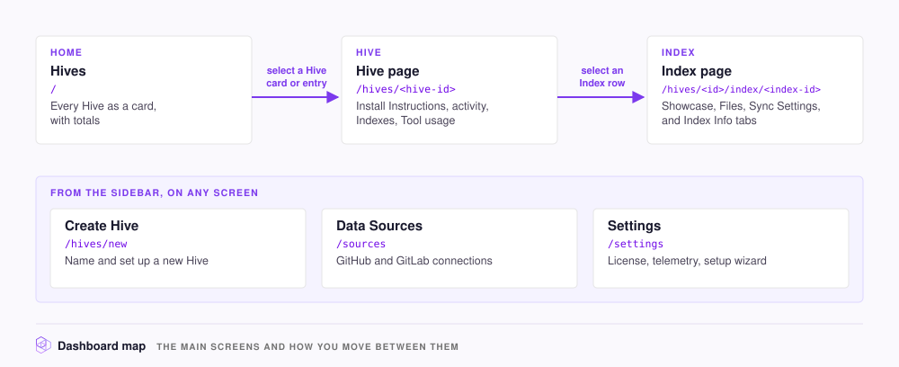

# Dashboard tour

The dashboard is where you manage your [Hives](../concepts/glossary.md#hive) and [Indexes](../concepts/glossary.md#index), and it opens in your browser. Use it to create a Hive, connect a repository, or see what your agents stored and searched. By default, the dashboard runs at `http://localhost:3577`. If you installed NeoHive with a different `NEOHIVE_PORT`, or on another machine, use that port or address instead.

This page explains each screen of the dashboard and what you can do on it.

A Hive is the workspace your agent connects to, and an Index is one store of searchable context inside a Hive. For more terms, see the [NeoHive glossary](../concepts/glossary.md).

<figure><figcaption></figcaption></figure>

## Before your first Hive

The first time you open the dashboard, it asks you to accept the **NeoHive Design Partner Licence** agreement. For details, see [Accept the license agreement](licensing.md#accept-the-license-agreement).

While NeoHive has no Hives, the dashboard opens the **Welcome** screen instead of the home screen. **Welcome** explains Hives and Indexes, and then **Start setup** opens the setup wizard. The wizard creates your first Hive in three steps: **Name Hive**, **Configure first Index**, and **Install for your AI tools**. For the full steps, see [Install NeoHive](../get-started/install.md).

To go through the wizard again later, open **Settings** and select **Run setup wizard**. The wizard does not reset or delete anything.

## The home screen and sidebar

The home screen gives you an overview of all your Hives, with one card for each Hive. A card shows the Hive's number of Indexes and [Memories](../concepts/glossary.md#memory), and when it last synced. To open a Hive, select its card.

The sidebar lists the same Hives under **Hives**, so you can switch Hives from any screen. **New Hive**, **Data Sources**, and **Settings** are also in the sidebar.

Three totals across all of your Hives sit at the top of the home screen:

| Total | What it counts |
|---|---|
| **Total Memories** | Every Memory in every Hive, including indexed code and files |
| **Added via MCP** | Memories that your agents stored through [MCP](../concepts/glossary.md#mcp), for example with `memory_store` |
| **Queries (30d)** | Searches that agents and the dashboard ran in the last 30 days |

To show a 30-day trend line under each total, turn on **Trends**.

To see a Hive's actions, select the three-dot icon (⋮) on its card. In the sidebar, the same menu opens from the three-dot icon (⋯) that appears when you point at a Hive.

| Menu option | What it does |
|---|---|
| **Edit** | Changes the Hive's name and icon |
| **Pin** or **Unpin** | Keeps up to two Hives in a **Pinned** row at the top of the home screen. Available on cards only |
| **Copy MCP command** | Copies the command that connects Claude Code to this Hive |
| **Archive** | Moves the Hive to **Archived**, where you can restore it for 30 days. See [Manage Hives and Indexes](manage.md) |
| **Delete** | Deletes the Hive and everything in it. See [Manage Hives and Indexes](manage.md) |

## The Hive page

A Hive page shows how to connect agents to one Hive, the Indexes it searches, and what your agents did in it.

### Install Instructions

**Install Instructions** gives ready-made commands that connect Claude Code, Claude Desktop, Codex, or Cursor to the Hive. After an agent connects, the section collapses. To see the commands again, select **Reinstall**. For the full steps, see [Connect your agent](../get-started/connect/README.md).

### Indexes

**Indexes** lists every Index in the Hive, including any [Shared Index](../concepts/glossary.md#shared-index) from another Hive, which has a **Shared** badge. To open an Index, select its row. To add an Index, select **+** next to **Indexes**.

To see an Index's actions, point at its row and select the three-dot icon (⋮). For what each action does, see [Manage Hives and Indexes](manage.md). **Sync Queue** lists the repository syncs that are running or waiting.

### Activity

| Part | What it shows |
|---|---|
| **AT A GLANCE** | **Memories** in the Hive, **Learnings 7d** (Memories your agents stored in the last 7 days), **Queries 7d** (searches in the last 7 days), and **Last activity** |
| **Recent learnings**, **Recent queries**, **All activity** | The latest Memories, searches, and other events |
| **Tool usage** | Requests from each kind of agent, such as Claude Code or Cursor |

### Messages on the Hive page

| Message | When it appears |
|---|---|
| A sync error, such as `A git command failed`, with `The <name> Index stopped syncing.` | An Index's last sync failed. Select the link in the box to open the Index. For each error and its fix, see [Repository sync issues](../troubleshooting/sync.md) |
| `This Hive has no Indexes yet` | The Hive has only its Knowledge Index. To add one, select **Add an Index** |
| `Selected models exceed your VRAM budget` | The Hive's Indexes use embedding models that do not fit in GPU memory together. Searches still work but run one Index at a time. See [Embedding models](embedding-models.md) |

## The Index page

An Index page shows one Index: its size, its last sync, and its settings. The stats at the top show the Index's **Memories**, the **Files** that have Memories in the Index, the **Last sync**, and the disk space the Index uses (**On disk**). For a GitHub or GitLab Index, **Trigger sync** starts a sync right away.

The page has the following tabs:

| Tab | Shown for | What's there |
|---|---|---|
| **Showcase** | Every Index | The files or Memories that agents retrieve most often |
| **Files** | [Files Indexes](../concepts/glossary.md#files-index) | Uploaded files and a drop zone for more. See [Add documents and PDFs](../context/documents.md) |
| **Sync Settings** | [Code](../concepts/glossary.md#code-index) and [Documentation Indexes](../concepts/glossary.md#documentation-index) | **Sync history**, the connection, branch, **Sync interval**, file filters, and **Pause syncing**. See [Keep it up to date](../context/repositories/sync.md) |
| **Index Info** | Every Index | Name, description, [embedding model](../concepts/glossary.md#embedding-model), **Share Index…**, **Move Index…**, and **Danger zone**. See [Embedding models](embedding-models.md) and [Manage Hives and Indexes](manage.md) |

When a sync fails, a message box at the top of the page names the error. For each error and its fix, see [Repository sync issues](../troubleshooting/sync.md). When you change the embedding model, a message box shows the progress of the re-embed. See [Embedding models](embedding-models.md).

## The Data Sources screen

**Data Sources**, in the sidebar, lists the GitHub and GitLab connections that your Code and Documentation Indexes sync through. Services you have connected appear under **Connected**, and the rest appear under **Available**. To add, check, or replace a connection, see [Data sources and credentials](data-sources.md).

## The Settings screen

| Card | What you do there |
|---|---|
| **Default Index Type** | Select **Knowledge Base** or **Code Repository** as the default for new Indexes. You can still choose a different type for each Index |
| **Server Status** | See whether your browser can reach NeoHive. To check again, select **Retry** |
| **Setup Wizard** | **Run setup wizard** takes you through setup again. The wizard does not reset or delete anything |
| **Licence Key** | **Manage licence** opens your license status. For details, see [Licensing](licensing.md) |
| **Design Partner Licence Agreement** | **View licence** shows the agreement you accepted on first run |
| **Anonymous Telemetry** | Turn off sharing of anonymized performance data. NeoHive never sends your prompts, code, or Memories |

## Keyboard shortcuts

| Keys | Action |
|---|---|
| `Cmd+K` or `Ctrl+K`, or `/` | Search palette: jump to a Hive, a connection, **Data Sources**, or **Settings** |
| `G` then `D` | Home screen |
| `G` then `S` | **Settings** |
| `Cmd+B` or `Ctrl+B` | Show or hide the sidebar |
| `?` | All shortcuts |
