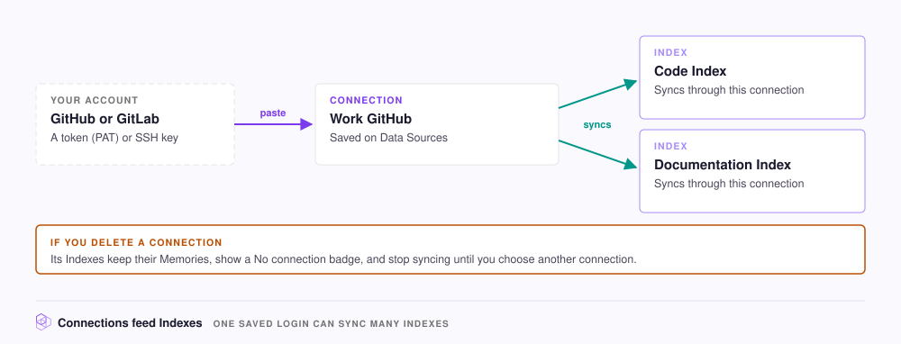

# Data sources and credentials

A connection is a saved login that lets NeoHive read from one account on a service, such as a GitHub or GitLab account. [Code](../concepts/glossary.md#code-index) and [Documentation Indexes](../concepts/glossary.md#documentation-index) sync through a connection, so a connection that stops working stops their syncs too. You can add a connection, check that the connection still works, and replace its token without a gap in syncing.

For more terms, see the [NeoHive glossary](../concepts/glossary.md).

To see your connections, open **Data Sources** at the bottom of the sidebar.

<figure><figcaption></figcaption></figure>

| Service | Use it for | Credential |
|---|---|---|
| **GitHub** | Repositories on `github.com` | Personal access token (PAT) or SSH private key |
| **GitLab** | Repositories on `gitlab.com` or your own GitLab server | Personal access token or SSH private key |
| **Jira** | You cannot connect Jira. The card shows **Coming soon** | None |

## Add a connection

To add a connection, do the following:



## Open the form

On the **GitHub** or **GitLab** card under **Available**, click **Install**. If you are adding an Index, you can instead select **Add a new connection** from the **Connection** list.



## Fill in the form

| Field | What to enter |
|---|---|
| **GitLab Base URL** | This field is for GitLab only. Enter your server address, such as `https://gitlab.example.com`, before you click **Create a PAT**, or the link opens `gitlab.com`. Leave the field blank for `gitlab.com` |
| **Name** | Enter a label, such as `Work GitHub`. You can use each name only once for each service |
| **PAT** or **SSH** | Paste a **Personal Access Token**, or switch to **SSH** and paste an **SSH Private Key** |

**Create a PAT** opens your provider's token page with the required scopes already selected. For the scopes on each provider, see [Create a token](../context/repositories/connect.md#create-a-token).

To create the token yourself, follow [Creating a personal access token (classic)](https://docs.github.com/en/authentication/keeping-your-account-and-data-secure/managing-your-personal-access-tokens#creating-a-personal-access-token-classic) on GitHub, or [Create a personal access token](https://docs.gitlab.com/user/profile/personal_access_tokens/#create-a-personal-access-token) on GitLab.



## Save the connection

Click **Save connection**. If you already added the same token, or another connection uses the same account, the form shows a warning. To keep both, click **Add anyway**. NeoHive then checks the token with the service. If the service rejects the token, NeoHive does not save the connection.




**Check:** the service now appears under **Connected**, and **Manage** lists your connection as **Valid**.


## Check or remove a connection

To check a connection, click **Manage** on its card under **Connected**. The connection shows one of the following states:

| State | Meaning |
|---|---|
| **Valid** | The last check passed |
| **Invalid** | The service rejected the credential. Replace the credential |
| **Unvalidated** | NeoHive saved the connection but could not check it, for example because the service was unreachable |

NeoHive checks a connection when you save it. To check it again, such as after you change the token's permissions, click **Validate** on the connection.

**Bound Indexes** lists the [Indexes](../concepts/glossary.md#index) in your current [Hive](../concepts/glossary.md#hive) that sync through the connection. **Delete** removes the connection.


When you delete a connection, every Index that syncs through the connection can no longer sync. Scheduled syncs keep running and fail until you click **Assign connection** on the Index page, or pause syncing. The Indexes keep their [Memories](../concepts/glossary.md#memory) and show a **No connection** badge.


## Replace a token

To replace a token without a gap in syncing, do the following:

1. Create a new token with the provider, and keep the old token active.
2. Add a new connection with the new token.
3. On each affected Index, open the **Sync Settings** tab.
4. Under **Connection**, select the new connection.
5. Click **Save settings**.
6. Delete the old connection.
7. Revoke the old token with the provider.

The Indexes now sync through the new connection.

To learn how NeoHive stores these secrets, see [Credentials and secrets](../security/credentials.md).
