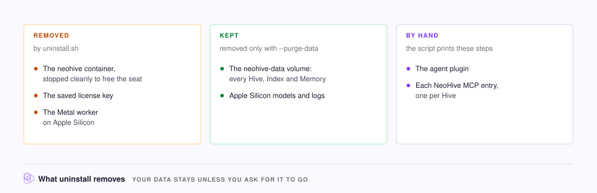

# Uninstall

When you no longer want NeoHive on this machine, the uninstall script removes what the installer put there. You decide whether your data goes too. Your data is every [Hive](../concepts/glossary.md#hive), [Index](../concepts/glossary.md#index), and [Memory](../concepts/glossary.md#memory) on this machine, and the script keeps it unless you pass `--purge-data`. After the script runs, you disconnect your agents by hand.

The uninstall script lists what it found and asks you to confirm once.

<figure><figcaption></figcaption></figure>


Do not use `docker rm -f neohive` as a shortcut. That command stops the container without a clean shutdown. The license seat then stays in use until the licensing service notices that the machine has stopped checking in.


To uninstall NeoHive, follow these steps.



## Preview the plan

To see what the script would remove without changing anything, run the script with `--dry-run`:

```bash
curl -fsSL https://raw.githubusercontent.com/NeoHiveAI/install/main/uninstall.sh \
  | bash -s -- --dry-run
```



## Remove NeoHive



```bash
curl -fsSL https://raw.githubusercontent.com/NeoHiveAI/install/main/uninstall.sh | bash
```

If you install NeoHive again later, the new install finds your Hives as you left them.




Deleting the volume permanently removes every Hive, Index, and Memory. You can get them back only from a backup. See [Backups and restore](backups.md).


```bash
curl -fsSL https://raw.githubusercontent.com/NeoHiveAI/install/main/uninstall.sh \
  | bash -s -- --purge-data
```

The `--purge-data` option also deletes the data volume and the Apple Silicon models and logs. If NeoHive is running, the script offers a backup first. Then the script asks you to type the volume name before it deletes anything. If the name you type does not match, the script still removes NeoHive but keeps the data volume and the Apple Silicon models and logs.



The `--yes` flag skips the questions. Use `--yes` only in scripts. With `--purge-data`, `--yes` also skips the backup offer and the typed volume name. The script then deletes the volume without asking.



## Remove the agent plugin

The script cannot reach your agent, so remove the plugin yourself, as shown for your agent in the following tabs. Apps with no NeoHive plugin, such as ChatGPT and Claude Desktop, have no plugin to remove.



In a Claude Code session, run:

```text
/plugin uninstall neohive@neohive-claude
```



Delete `~/.cursor/plugins/local/neohive`.



Run `codex`, enter `/plugins`, open **NeoHive** on its marketplace tab, and uninstall it.





## Remove the MCP entries

Removing the plugin can leave the [MCP](../concepts/glossary.md#mcp) entries behind, one NeoHive entry for each Hive. Remove them as shown for your agent in the following tabs.



In each project folder where you connected a Hive, list the entries, and then remove each NeoHive entry:

```bash
claude mcp list
claude mcp remove <neohive-entry>
```



Delete the NeoHive entries from `.cursor/mcp.json` in your project, or from `~/.cursor/mcp.json`.



Delete the NeoHive entries from `.codex/config.toml` in your project, or from `~/.codex/config.toml`.



In the ChatGPT desktop app, open **Settings**, then **Plugins**, and remove each NeoHive server.



Delete the NeoHive entries from `claude_desktop_config.json`, and then restart Claude Desktop.



For any other agent, remove the NeoHive server from wherever you added it: its MCP config file or its settings screen.




**Check:** To confirm that NeoHive is gone, run the following command:

```bash
docker ps -a --filter name=neohive
```

The list is empty, and `claude mcp list` shows no NeoHive entries in any of those project folders.

