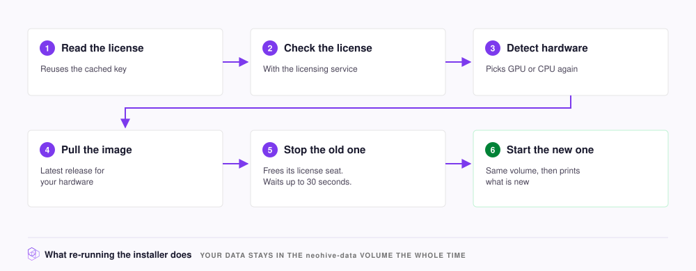

# Update NeoHive

An update replaces the NeoHive container with a new one that runs the latest release. Your data does not live inside the container: NeoHive keeps it in the `neohive-data` Docker volume, and the new container starts on that same volume. Your [Hives](../concepts/glossary.md#hive), [Indexes](../concepts/glossary.md#index), and [Memories](../concepts/glossary.md#memory) stay in place.

To update, you run the installer again. The command is the same one you used to install NeoHive, and you can copy it from [Run the update](#run-the-update) on this page. The installer does not remember the variables you installed with, such as a different port, so you add them to the command again. Take a [backup](backups.md) first, so that you can restore your data if the update fails.

<figure><figcaption></figcaption></figure>

## Know when an update is out

The dashboard checks for new releases automatically. When a release is out, a dot appears on the **Updates** bell icon in the top bar.

To see the details, select the bell icon. The **NeoHive updates** panel shows the new version, the version you run, and the installer command. To check again now, select the refresh icon in the panel. The panel does not install the update for you.

To read what changed in each release, open **Release Notes** in the sidebar, or select **View full changelog** in the panel to open the [NeoHive changelog](https://github.com/NeoHiveAI/install/blob/main/CHANGELOG.md).

## Run the update


If a repository sync is still running when the old container stops, the sync stops before it finishes. The sync runs again at its next scheduled time. To run the sync sooner, open the Index and select **Trigger sync**.




## Take a backup

A backup copies everything NeoHive stores into one archive, so you can restore your data if the update fails. To take one, follow [Take a backup](backups.md#take-a-backup).



## Run the installer again

If you installed NeoHive with any variables, such as `NEOHIVE_PORT`, add them to the command first. See [Set the same variables you installed with](#set-the-same-variables-you-installed-with).

```bash
bash <(curl -fsSL https://raw.githubusercontent.com/NeoHiveAI/install/main/install.sh)
```

The installer reuses your cached license key. To use a different license, see [Replace your license](licensing.md#replace-your-license). On Apple Silicon, the installer also updates the [Metal worker](../concepts/glossary.md#metal-worker), the part of NeoHive that runs on the Mac's GPU, and keeps the models it already downloaded.



## Set the same variables you installed with

The installer does not remember the variables from your last install. Any variable you leave out goes back to its default value. For example, if you installed NeoHive on port `4000` with `NEOHIVE_PORT`, an update without that variable moves NeoHive back to port `3577`, and agents that use port `4000` cannot connect. When you update, set each of the following variables that you set when you installed:

| Variable | Why you set it |
|---|---|
| `NEOHIVE_PORT` | NeoHive runs on a port other than `3577` |
| `NEOHIVE_BACKEND` | You forced a backend. See [GPU and CPU](gpu-cpu.md) |
| `NEOHIVE_METAL_WORKER`, `NEOHIVE_METAL_WORKER_PORT` | You turned off or moved the Metal worker |
| `NEOHIVE_PDF_BRIDGE_TIMEOUT_MS`, `NEOHIVE_PDF_WARMUP_TIMEOUT_MS`, `NEOHIVE_CHUNKER_TIMEOUT_MS` | You gave large files more time |

For example, the following command sets a different port and forces the CPU backend:

```bash
NEOHIVE_PORT=4000 \
NEOHIVE_BACKEND=cpu \
  bash <(curl -fsSL https://raw.githubusercontent.com/NeoHiveAI/install/main/install.sh)
```

For the full list of variables, see [Environment variables](../reference/environment-variables.md).


**Check:** To confirm that NeoHive is running again, run the following command:

```bash
curl http://localhost:3577/health
```

The reply contains `"status":"ok"`. The version at the bottom of the sidebar shows the new release.

