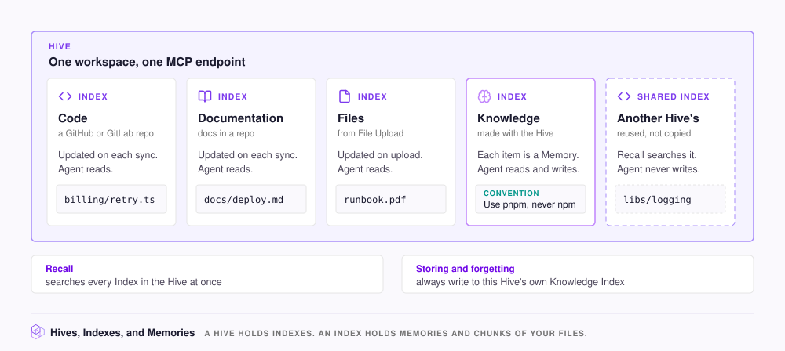

# Hives, Indexes, and Memories

One Hive is one shared memory: every agent connected to the Hive sees the same context, in every tool. NeoHive organizes that context in three levels:

* A **Hive** is a workspace for one codebase or team.
* An **Index** stores one kind of content inside a Hive, such as your code.
* A **Memory** is one note that your agent stores, such as a convention.

For more information about which Index to use for each kind of content, see [What to add, and where](../context/what-to-add.md). The following diagram shows one Hive with one Index of each type:

<figure><figcaption></figcaption></figure>

## Hives

A Hive keeps the context for one codebase or team separate from unrelated work.

* **Every agent connected to a Hive shares its context.** Each Hive has one [MCP](glossary.md#mcp) endpoint, so a convention that one teammate teaches comes back for everyone.
* **Use one Hive per codebase or team.** Put closely related code, such as the services in one monorepo, in one Hive. Keep unrelated codebases in separate Hives.

## Indexes

An Index holds one kind of content inside a Hive. The following table shows each Index type:

| Index | What it holds | Who writes to it |
|---|---|---|
| **Code** | The source code of a Git repository, such as one on GitHub or GitLab | NeoHive, on every sync |
| **Documentation** | The docs in a Git repository, such as one on GitHub or GitLab | NeoHive, on every sync |
| **Files** | Documents, PDFs, and images that you add with **File Upload** | NeoHive, on each upload |
| **Knowledge** | What your agents learn as you work | Your agents, through `memory_store` |

NeoHive creates one Knowledge Index with each Hive, and you cannot add a second one.

A Hive can hold many Indexes, but your agent searches them all at once. One `memory_recall` call searches every Index in the Hive and returns code, docs, and Memories together. For more information about what one recall does, see [How retrieval works](retrieval.md).

## Shared Index

A Shared Index is a Code, Documentation, or Files Index that another Hive owns. NeoHive adds the Shared Index to your Hive without copying the Index or indexing its files again.

Recall searches a Shared Index the same way as the Hive's own Indexes. You cannot share a Knowledge Index. Either Hive can start the share. To share or add an Index, see [Share an Index between Hives](../admin/manage.md#share-an-index-between-hives).

A Hive that uses a Shared Index can change almost everything that the owning Hive can change:

| Action | Owning Hive | Hive that uses the Index |
|---|---|---|
| Sync the Index, or change its connection, branch, file patterns, and embedding model | Yes | Yes |
| Delete repositories or files from the Index | Yes | Yes |
| Delete the Index | Yes, after every other Hive stops using it | No |
| Share the Index with another Hive, or move it | Yes | No |
| Stop using the Index (**Remove from Hive**) | Not applicable | Yes |


Both Hives use the same Index, not a copy. A change made from either Hive applies to both.


## Memories

A Memory is one note that your agent saves in a Knowledge Index. Examples are a convention, a decision, a correction, or a problem to watch out for. A Memory also keeps the reasoning behind a choice, so teammates can find that reasoning later.

Your agent stores a Memory when the agent finds something worth keeping on its own. The agent also stores a Memory when you ask the agent to remember something, for example:

```text
Remember that we always use snake_case for database column names.
```

Each Memory has:

* A type, a label such as `convention` or `decision`. Your agent chooses the type. For more information about each type, see [Memory types](../reference/memory-types.md).
* An importance, a number from `1` to `10`. A higher number helps the Memory rank higher in recall.

Your agent calls `memory_forget` when it learns that a Memory is out of date, usually because you said so, and recall stops returning that Memory. If you state only the new fact, the old Memory stays active too. For what to say, see [Say "out of date" when a fact changes](../results/teach.md#say-out-of-date-when-a-fact-changes).

Code, Documentation, and Files Indexes hold [chunks](glossary.md#chunk) instead of Memories. A chunk is a section of a file, such as a function, or a heading and its text. NeoHive gives each chunk a type and an importance too. A rule written in a README can then come back from recall like a Memory.
