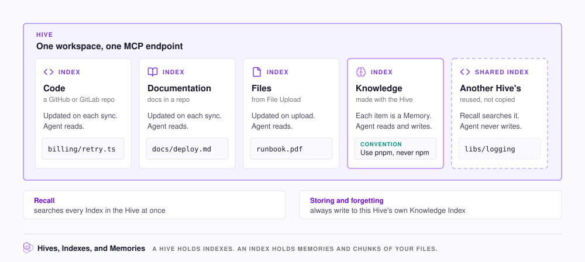

# Hives, Indexes, and Memories

One Hive is one shared memory: every agent connected to it sees the same context, in every tool. NeoHive organizes that context in three levels:

* A **Hive** is a workspace for one codebase or team.
* An **Index** stores one kind of content inside a Hive, such as your code.
* A **Memory** is one lesson that your agent stores, such as a convention.

For which Index to use for each kind of content, see [What to add, and where](../context/what-to-add.md).

<figure><figcaption></figcaption></figure>

## Hives

A Hive keeps the context for one codebase or team separate from unrelated work.

* Each Hive has one [MCP](glossary.md#mcp) endpoint. A convention one teammate teaches comes back for everyone connected to it.
* Put closely related code, such as the services in one monorepo, in one Hive.
* Keep unrelated codebases in separate Hives.

## Indexes

An Index holds one kind of content inside a Hive, with its own storage and its own [embedding model](glossary.md#embedding-model).

| Index | What it holds | Who writes to it |
|---|---|---|
| **Code** | The source code of a GitHub or GitLab repository | NeoHive, on every sync |
| **Documentation** | The docs in a GitHub or GitLab repository | NeoHive, on every sync |
| **Files** | Documents and PDFs that you add with **File Upload** | NeoHive, on each upload |
| **Knowledge** | What your agents learn as you work | Your agents, through `memory_store` |

NeoHive creates one Knowledge Index with each Hive, and you cannot add a second one. Your agent does not need to choose an Index: one `memory_recall` call searches every Index in the Hive and returns code, docs, and Memories together. [How retrieval works](retrieval.md) explains what one recall does.

## Shared Index

A Shared Index is a Code, Documentation, or Files Index that another Hive owns. NeoHive adds it to your Hive without copying it or indexing its files again.

* Recall searches the Shared Index, but your agents never write to it. `memory_store` and `memory_forget` always write to your own Knowledge Index.
* You cannot share a Knowledge Index.
* You can share an Index from the Hive that owns it, or add another Hive's Index from your own Hive. For the steps, see [Share an Index between Hives](../admin/manage.md#share-an-index-between-hives).

A Hive that uses a Shared Index can change almost everything that the owning Hive can change:

| Action | Owning Hive | Hive that uses the Index |
|---|---|---|
| Sync the Index, or change its connection, branch, file patterns, and embedding model | Yes | Yes |
| Delete repositories or files from the Index | Yes | Yes |
| Delete the Index | Yes, after every other Hive stops using it | No |
| Share the Index with another Hive, or move it | Yes | No |
| Stop using the Index (**Remove from Hive**) | Not applicable | Yes |


Both Hives use the same Index, not a copy. A change made from either Hive applies to both.


## Memories

A Memory is one stored piece of knowledge in a Knowledge Index: a convention, a decision, a correction, or a problem to watch out for. The reasoning behind a choice is the first thing a team loses, and a Memory is where NeoHive keeps it.

Your agent stores a Memory when you ask it to remember something, and when it finds something worth keeping on its own. For example:

> Remember that we always use snake_case for database column names.

Each Memory has:

* **A type**, a label such as `directive`, `convention`, `decision`, or `error_pattern`. Your agent chooses the type. [Memory types](../reference/memory-types.md) lists every type.
* **Tags**, words that help later searches find the Memory.
* **An importance**, a number from `1` to `10`. The default is `5`, and a higher number helps the Memory rank higher in recall.

When a Memory is out of date, your agent calls `memory_forget`. The Memory is deactivated, not deleted, so recall stops returning it, and the call can name the Memory that replaces it. [Teach your agent as you work](../results/teach.md) shows what to say.

Code, Documentation, and Files Indexes hold [chunks](glossary.md#chunk) instead of Memories. A chunk is a section of a file, such as a function, or a heading and its text. NeoHive gives each chunk a type and an importance too, so a rule written in a README can come back from recall like a Memory does.
