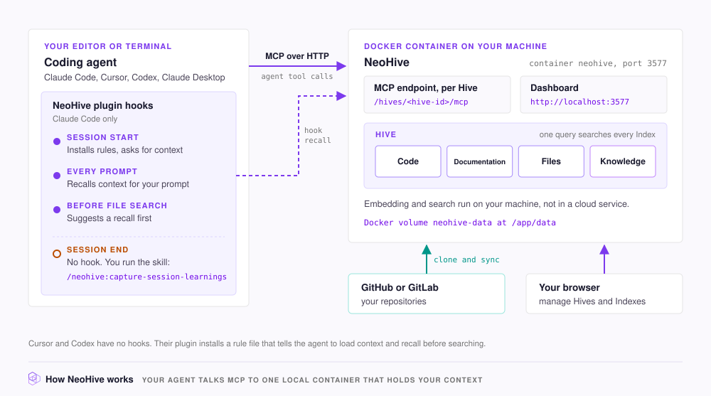

# How NeoHive works

NeoHive has three parts, and together they give every agent on your team one shared memory:

1. **Your coding agent asks.** It describes what it needs and calls NeoHive over [MCP](glossary.md#mcp).
2. **The plugin decides when.** Inside the agent, it says when to ask for context and when to store a lesson.
3. **The container answers.** It holds your code, docs, and team knowledge, and returns the right part.

Whatever tool a teammate uses, their agent reads the same memory, and what one person teaches it, every agent gets back.

<figure><figcaption></figcaption></figure>

## The three parts

| Part | Where it runs | What it does |
|---|---|---|
| Your agent | Your editor or terminal | Calls NeoHive's tools, such as `memory_recall` and `memory_store`. |
| The NeoHive plugin | Inside Claude Code, Cursor, or Codex | Installs a [rules file](glossary.md#rules-file) that says when to use memory. In Claude Code, it also runs hooks at fixed points in a session. |
| The NeoHive container | Docker, on your machine or a shared server | Stores your [Hives](glossary.md#hive) and [Indexes](glossary.md#index), answers each question, and syncs your repositories. |

* **Your agent never reads NeoHive's files.** It asks through an MCP tool and gets matching code, docs, and [Memories](glossary.md#memory) back. [MCP tools](../reference/mcp-tools.md) lists every tool.

## The container

NeoHive is one Docker container named `neohive`. Your code, documents, and Memories never leave the machine it runs on.

Inside it, a Hive is a workspace for one codebase or team, and each Index holds one kind of context, such as your code or your team's Memories. [Hives, Indexes, and Memories](hives-indexes-memories.md) explains the three levels.

| What | Where |
|---|---|
| Dashboard, where you manage your Hives | Your browser, at the address the installer prints |
| MCP endpoint, one for each Hive | `/hives/<hive-id>/mcp` |
| Everything the container stores | The `neohive-data` Docker volume, mounted at `/app/data` inside the container |

## What the plugin runs



Two hooks do most of the work:

* **When a session starts**, a hook installs the plugin's rules file.
* **When you send a prompt**, a hook runs `memory_recall` on it and adds the results to the agent's context before the agent answers.

No hook runs when a session ends. To save what your agent learned, run `/neohive:capture-session-learnings`.



These plugins have no hooks. Their rules file tells the agent to load context at the start of a session and to recall before it searches files.



Claude Desktop and other MCP apps have no plugin. Add the rules from [Tell your agent to use NeoHive](../get-started/connect/README.md#tell-your-agent-to-use-neohive) so the agent knows when to call NeoHive.



[What the plugin does automatically](../results/plugin-automation.md) lists every hook and how to turn it off.

## Repositories

When you add a repository, the container does the following:

1. Copies (clones) the repository from GitHub or GitLab into the `neohive-data` volume.
2. Splits each file into [chunks](glossary.md#chunk).
3. Turns each chunk into an [embedding](glossary.md#embedding).
4. Stores the chunks and their embeddings in a [Code](glossary.md#code-index) or [Documentation Index](glossary.md#documentation-index).

Later syncs index only the files that changed, so the memory keeps itself current with no upkeep.

Embedding and search both run inside the container. [What stays on your machine](../security/local-only.md) lists every connection it makes to outside services.

## Next


[Hives, Indexes, and Memories](hives-indexes-memories.md)

