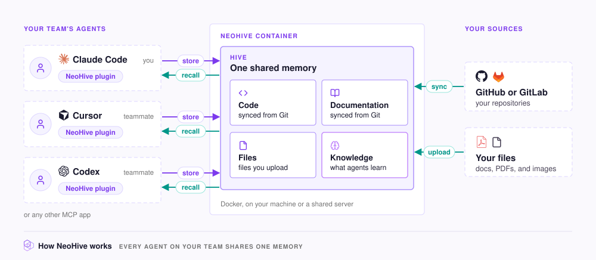

# How NeoHive works

NeoHive gives every coding agent on your team one shared memory. Your agent connects to NeoHive over [MCP](glossary.md#mcp), and the NeoHive plugin tells the agent when to use memory. The memory itself runs in a Docker container on your machine or a shared server. Knowing where each part runs helps you set NeoHive up and find the cause when an agent cannot reach NeoHive.

Every teammate's agent reads the same memory, whichever tool the teammate uses. When one person teaches their agent a lesson, every other agent can recall that lesson. The following diagram shows three teammates' agents sharing one [Hive](glossary.md#hive):

<figure><figcaption></figcaption></figure>

Your agent does not read NeoHive's files. The agent asks through an MCP tool, such as `memory_recall` or `memory_store`, and gets matching code, docs, and [Memories](glossary.md#memory) back. For more information about each tool, see [MCP tools](../reference/mcp-tools.md).

## Your agents and the plugin

The plugin installs a [rules file](glossary.md#rules-file) that tells your agent when to use memory. To install the plugin, see [Connect your agent](../get-started/connect/README.md). What else the plugin runs depends on your tool:



Two hooks do most of the work:

* When a session starts, a hook installs the plugin's rules file.
* When you send a prompt, a hook runs `memory_recall` on the prompt. The hook adds the results to the agent's context before the agent answers.

To save what your agent learned, run `/neohive:capture-session-learnings` before you close the session.



These plugins have no hooks. Their rules file tells the agent to load context at the start of a session and to recall before it searches files. To save what your agent learned, run the `capture-session-learnings` skill before you close the session.



Claude Desktop and other MCP apps have no plugin. To tell the agent when to call NeoHive, add the rules from [Tell your agent to use NeoHive](../get-started/connect/README.md#tell-your-agent-to-use-neohive).



For more information about each hook and how to turn the hook off, see [What the plugin does automatically](../results/plugin-automation.md).

## The NeoHive container

NeoHive is one Docker container named `neohive`. The container keeps your code, documents, and Memories on the machine it runs on.

The container holds your Hives and their [Indexes](glossary.md#index). For more information about Hives and Indexes, see [Hives, Indexes, and Memories](hives-indexes-memories.md). The container also provides the following:

* **You manage your Hives in the dashboard.** The dashboard opens in your browser at the address the installer prints, `http://localhost:3577` by default.
* **Each Hive has its own MCP endpoint.** The endpoint path is `/hives/<hive-id>/mcp`.
* **One Docker volume holds all your data.** Your data lives in the `neohive-data` volume.

## Your sources

NeoHive indexes two kinds of source: repositories that it syncs, and files that you upload.

When you add a repository, the container does the following:

1. Copies (clones) the repository, such as one on GitHub or GitLab, into the `neohive-data` volume.
2. Splits each file into [chunks](glossary.md#chunk).
3. Turns each chunk into an [embedding](glossary.md#embedding).
4. Stores the chunks and their embeddings in a [Code](glossary.md#code-index) or [Documentation Index](glossary.md#documentation-index).

Later syncs index only the files that changed. Syncs also run on a schedule, so a Code or Documentation Index stays up to date with its repository.

When you upload a file, such as a document, PDF, or image, NeoHive indexes the file the same way, in a [Files Index](glossary.md#files-index). An uploaded file does not sync, so upload the new version when the file changes. For more information, see [Add documents and images](../context/documents.md).

NeoHive embeds and searches your content on the machine it runs on. On a Mac with Apple Silicon, embedding runs in the [Metal worker](glossary.md#metal-worker), outside the container. For more information about each connection the container makes to outside services, see [What stays on your machine](../security/local-only.md).
