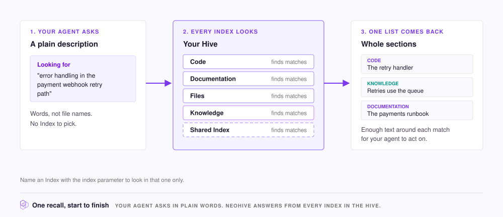

# How retrieval works

Recall is how your agent gets context from NeoHive while it works. The agent asks in plain words, and NeoHive answers from every Index at once: the matching code, docs, and [Memories](glossary.md#memory), in one list.

<figure><figcaption></figcaption></figure>

## What one recall does

Your agent describes what it needs in plain words. In one recall, NeoHive does the following:

1. **Searches every Index at once**, including any [Shared Index](glossary.md#shared-index).
2. **Matches meaning and exact words.** A description finds text about the same thing, even when it uses different words. A function name or an error code finds the text that contains it.
3. **Ranks the matches into one list.** A Memory with a higher importance ranks higher.
4. **Returns whole sections.** A match in a document returns the whole section under its heading. A match in code returns the whole file, or the first 200 lines of a long file.
5. **Lists each section once**, even when several parts of it match.

Each result also shows its type, importance, and tags.

## Two ways to ask

* **`memory_context`, at the start of a task.** It returns the directives and conventions that match the task you describe, and then other Memories and indexed content that match the task.
* **`memory_recall`, for a specific question in the middle of a task.**

Both tools search every Index unless you name one. In Claude Code, the plugin also calls `memory_recall` with each prompt you send. See [What the plugin does automatically](../results/plugin-automation.md).

## What you control

NeoHive sets the order. You set what to ask and where to look:

| To | Set |
|---|---|
| Find more of what you need | `queries`, with up to five phrasings of the same need. Different phrasings match different text. |
| Search one Index only | `index`. The search is faster and more focused when you know which Index holds the answer. |
| Get only certain kinds of result | `types`, such as `directive` and `convention`. NeoHive also gives each section of code and docs a type, so those sections can match too. |
| Get more or fewer results | `limit`. The default is 10. |

[MCP tools](../reference/mcp-tools.md) lists every parameter, with its default and limits.

When you do not know which Index holds the answer, search the whole Hive first to see which Index answers best. Then repeat the query with `index` set to that Index.

**Phrasing matters.** Name the tool and the problem, not just the topic:

* **Finds less:** "how do I fix GitHub Actions"
* **Finds more:** "GitHub Actions concurrency limit workaround"

## Put it into practice

If your repositories and documents are already added, you can skip **Add your context** and go to [Write prompts that retrieve well](../results/prompting.md).
