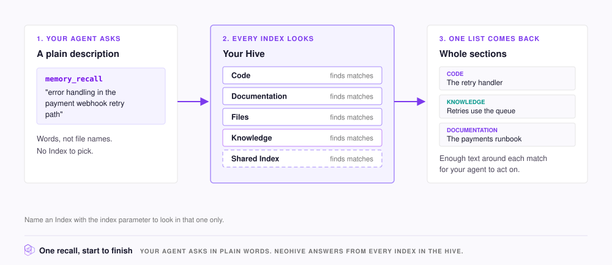

# How retrieval works

Recall is how your agent gets context from NeoHive while the agent works. The agent asks in plain words, and NeoHive answers from every [Index](glossary.md#index) in your [Hive](glossary.md#hive) at once. The answer is one list of matching code, docs, and [Memories](glossary.md#memory). Knowing what one recall does shows you which of your choices improve the results. The following diagram shows one recall:

<figure><figcaption></figcaption></figure>

## What one recall does

In one recall, NeoHive does the following:

1. **Searches every Index at once.** The search includes any [Shared Index](glossary.md#shared-index). A paused Index, or one with an error, is left out.
2. **Matches meaning and exact words.** A description finds text about the same thing, even when that text uses different words. A function name or an error code finds the text that contains that name or code.
3. **Ranks the matches into one list.** How well a match fits the query counts most. A result with a higher importance ranks higher. So does a result that your agents added or recalled recently.
4. **Returns whole sections.** A match in a document returns the whole section under its heading. A match in code returns the whole file, or the start of a long file, up to 200 lines.
5. **Lists each section once.** A section appears once even when several parts of the section match.

Each result also shows its type, importance, and tags.

## Two ways to ask

Your agent can ask in two ways. At the start of a task, `memory_context` returns the directives and conventions that match the task you describe. `memory_context` then returns decisions, known problems, and other lessons that match the task. Most code does not come back from `memory_context`. To find code, or to ask a specific question in the middle of a task, your agent calls `memory_recall`.

Both tools search every Index unless you name one. In Claude Code, the plugin also calls `memory_recall` with each prompt you send. For more information about the automatic recall on each prompt, see [What the plugin does automatically](../results/plugin-automation.md).

## What you control

NeoHive sets the order. You set what to ask and where to look:

| To | Set | How it helps |
|---|---|---|
| Find more of what you need | `queries` | Takes up to five phrasings of the same need. Different phrasings match different text. |
| Search one Index only | `index` | Makes the search faster and more focused when you know which Index holds the answer. |
| Get only certain kinds of result | `types` | Keeps only the types you name, such as `directive` and `convention`. NeoHive also gives each section of code and docs a type, so those sections can match too. |
| Get more or fewer results | `limit` | Sets how many results come back. The default is 10. |

For more information about each parameter, its default, and its limits, see [MCP tools](../reference/mcp-tools.md).

When you do not know which Index holds the answer, search the whole Hive first to see which Index answers best. Then repeat the query with `index` set to that Index.

The phrasing of a query also matters. Name the tool and the problem, not only the topic. For example, "GitHub Actions concurrency limit workaround" finds more than "how do I fix GitHub Actions".

## Put it into practice

If you already added your repositories and documents, you can skip **Add your context** and go to [Write prompts that retrieve well](../results/prompting.md).
