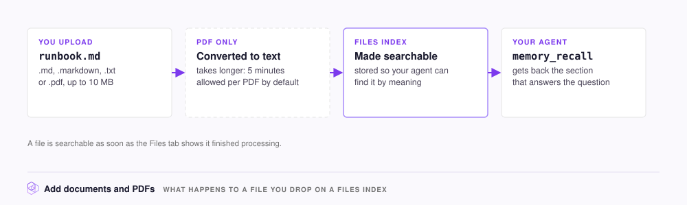

# Add documents and PDFs

A [Files Index](../concepts/glossary.md#files-index) holds documents that you upload, such as specs, runbooks, design docs, meeting notes, or an exported notes vault. NeoHive turns each file into text, and your agent recalls it the same way it recalls code. This page shows how to create a Files Index, upload files, and manage them later.

<figure><figcaption></figcaption></figure>

For markdown that already lives in a repository, add a [Documentation Index](../concepts/glossary.md#documentation-index) instead, because a Documentation Index stays in sync with the repository. For help choosing, see [What to add, and where](what-to-add.md).



## Create the Index

To create a Files Index, do the following:

1. Open your [Hive](../concepts/glossary.md#hive) at `http://localhost:3577`.
2. Select **+** next to **Indexes**.
3. Select **File Upload**.



## Add files

Optional: Drag files onto the **Files** drop zone, or select the drop zone to browse. The files upload after NeoHive creates the Index, so you can also skip this step and upload files later.

NeoHive accepts markdown, text, PDF, Word, Excel, and PowerPoint files, and PNG or JPEG images, up to 50 MB each. For details, see [Supported file types](../reference/file-types.md).



## Name and create the Index

NeoHive fills in **Index name** from the first file. To name and create the Index, do the following:

1. Change **Index name** to describe the documents, for example `Engineering Docs`.
2. Select **Create Index**.

Each file becomes searchable as soon as it finishes processing.



To help your agent choose this Index, set a **Description** on the **Index Info** tab. Name the kind of documents the Index holds. Your agent reads this description through `list_indexes`.

## Manage files later

To add more files, do the following:

1. Open the Index, and then select its **Files** tab.
2. Drag files onto the drop zone, or select the drop zone to browse.
3. Select the upload button, which shows the number of files, such as **Upload 3 files**.

The tab shows which file is processing and how much of the upload is done.

To replace a document, upload the new version with the same file name. NeoHive replaces the old file and its content. The new file must be the same type, except that markdown and text files can replace each other.


When you select the trash icon next to a file, NeoHive deletes the file and its content from the Index right away, without asking you to confirm.



To move an Obsidian vault or a similar notes vault, export it as markdown and upload the files.


## Large or scanned files

A large file can fail because it takes longer than five minutes to convert. To allow more time, see [Supported file types](../reference/file-types.md).

If a PDF is scanned, or draws its text as shapes, the file fails with `No text could be extracted from this document`. To fix the error, run optical character recognition (OCR) on the PDF, or export its text, and then upload the result.
