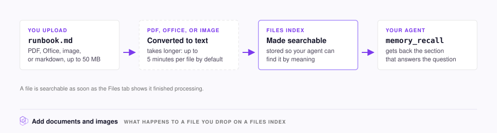

# Add documents and PDFs

A [Files Index](../concepts/glossary.md#files-index) holds documents that you upload, such as specs, runbooks, design docs, meeting notes, or an exported notes vault. NeoHive turns each file into text, and your agent recalls that text the same way as code. You create the Files Index once, and then add, replace, or delete its files whenever your documents change.

<figure><figcaption></figcaption></figure>

If your documents already live in a GitHub or GitLab repository, add the repository instead of uploading the files. Select **Documentation** as the content type, so NeoHive creates a [Documentation Index](../concepts/glossary.md#documentation-index). A Documentation Index stays in sync as the documents change, and an upload does not. To add the repository, see [Add a code repository](repositories/README.md).

## Create the Index

NeoHive accepts markdown, text, PDF, Word, Excel, and PowerPoint files, and PNG or JPEG images, up to 50 MB each. For details, see [Supported file types](../reference/file-types.md). To move an Obsidian vault or a similar notes vault, export it as markdown and upload the files.

To create a Files Index, do the following:

1. Open your [Hive](../concepts/glossary.md#hive) at `http://localhost:3577`.
2. Select **+** next to **Indexes**.
3. Select **File Upload**.
4. Optional: Drag files onto the **Files** drop zone, or select the drop zone to browse. The files upload after NeoHive creates the Index, so you can also skip this step and upload files later.
5. Enter an **Index name** that describes the documents, for example `Engineering Docs`. If you added files in step 4, NeoHive fills in **Index name** from the first file, and you can change the name.
6. Select **Create Index**.

Each file becomes searchable as soon as it finishes processing.

To help your agent choose this Index, set a **Description** on the **Index Info** tab. Name the kind of documents the Index holds. Your agent reads this description through `list_indexes`.

## Manage files later

To add more files, do the following:

1. Open the Index, and then select its **Files** tab.
2. Drag files onto the drop zone, or select the drop zone to browse.
3. Select the upload button, which shows the number of files, such as **Upload 3 files**.

The tab shows which file is processing and how much of the upload is done.

To replace a document, upload the new version with the same file name. NeoHive replaces the old file and its content. The new file must be the same type, except that markdown and text files can replace each other.


When you select the trash icon next to a file, NeoHive deletes the file and its content from the Index right away. NeoHive does not ask you to confirm.


## Large or scanned files

A large PDF, Office, or image file can fail because it takes longer than five minutes to convert. To allow more time, see [Supported file types](../reference/file-types.md).

NeoHive reads scanned pages with optical character recognition (OCR). If OCR finds no readable text, the file fails with `No text could be extracted from this document`. A faint scan, text drawn as shapes, or small or low-contrast text can cause the error. To fix the error, upload a clearer copy, or export the document's text and upload the result.
