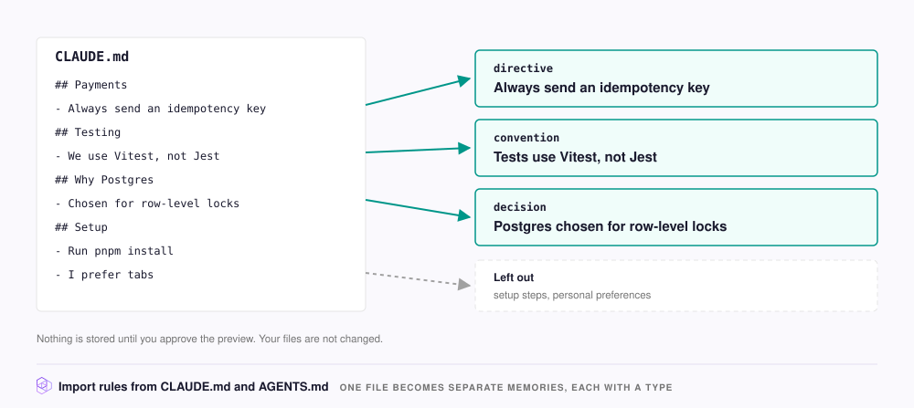

# Import rules from CLAUDE.md and AGENTS.md

Run one skill to turn the project rules in your context files, such as `CLAUDE.md`, into [Memories](../concepts/glossary.md#memory) (stored pieces of team knowledge). Every agent connected to your [Hive](../concepts/glossary.md#hive) can then recall those Memories, with no file to commit, pull, or merge.

<figure><figcaption></figcaption></figure>

Your agent loads all of `CLAUDE.md` on every task, even the parts that do not apply. Once the rules live in NeoHive instead, your agent recalls only the rules that matter for the current task.

## Run the migration

To start the migration, do the following:

1. Open your agent in the root folder of the project.
2. Run the skill, as shown for your agent in the following tabs.



```text
/neohive:migrate-memory
```

The skill reads the following files:

* `CLAUDE.md`, `AGENTS.md`, and `GEMINI.md`
* The `.md` files in `.claude/rules/`
* Any `CONVENTIONS*.md` or `CONTRIBUTING.md` under `docs/`

The skill never imports `~/.claude/CLAUDE.md`, which holds your personal preferences.



Ask your agent to run the `migrate-memory` skill.

The skill reads the following files:

* `CLAUDE.md`, `AGENTS.md`, and `GEMINI.md`
* The `.md` and `.mdc` files in `.cursor/rules/`, `.codex/rules/`, and `.claude/rules/`
* Any `CONVENTIONS*.md` or `CONTRIBUTING.md` under `docs/`

The skill never imports `~/.codex/AGENTS.md`, `~/.claude/CLAUDE.md`, or `~/.cursor/rules/`, which hold your personal preferences.



## Review and approve the Memories



## The skill lists the files

You see each project file that the skill reads. Files in your home folder show as skipped.



## The skill sorts the rules

Each rule or decision becomes its own Memory with a type, such as `directive`, `convention`, or `decision`. The skill leaves out setup steps, tables of contents, TODO lists, and personal preferences. The skill marks an entry that could be personal or team as ambiguous.



## You approve

If the skill asks which [Index](../concepts/glossary.md#index) to use, select **Knowledge**. A preview then shows what the skill plans to store and what it skipped. The skill stores nothing until you approve. You can remove items, re-classify the ambiguous ones, or stop.



## The skill stores the Memories

If the Hive already holds a rule as a Memory, the skill skips that rule. The skill stores the rest in the [Knowledge Index](../concepts/glossary.md#knowledge-index) and shows a summary.



To approve each Memory one at a time, add `review=each` to the command: `/neohive:migrate-memory review=each`.

The skill does not change your original files, and it skips the NeoHive block between the `<!-- BEGIN neohive-managed v=N -->` and `<!-- END neohive-managed v=N -->` markers. The plugin writes that block to tell your agent how to use your Hive, and updates it through the markers, so keep both in the file.

## After migrating

Your agent recalls migrated rules like any other Memory. A teammate on the same Hive gets the same rules without copying your `CLAUDE.md`.

The skill does not change `CLAUDE.md`, so your agent still loads every rule in it on each task. To load only the rules that matter, remove the migrated rules from `CLAUDE.md`. Keep the rules the skill skipped, such as personal preferences, and the NeoHive block.

If a rule migrated incorrectly or becomes out of date, tell your agent. Your agent then deactivates the old Memory. For details, see [Capture team knowledge](team-knowledge.md#correct-what-goes-stale).

Long-form notes, such as an Obsidian vault, design docs, or runbooks, belong in a [Files Index](../concepts/glossary.md#files-index). See [Add documents and PDFs](documents.md).
