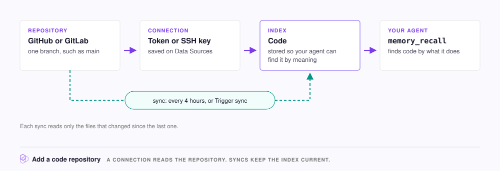

# Add a code repository

Connect a repository once, and your agent can find code by describing what the code does. NeoHive stores the code in a [Code Index](../../concepts/glossary.md#code-index), one store of searchable context inside your [Hive](../../concepts/glossary.md#hive). Scheduled syncs keep the [Index](../../concepts/glossary.md#index) up to date.

<figure><figcaption></figcaption></figure>

For example, your agent searches for `retry handling in the sync engine` and gets back the functions that handle retries, even when those words never appear in the file. The same search also returns your team's [Memories](../../concepts/glossary.md#memory), such as conventions and decisions.

Before you start, you need a Hive, read access to the repository, and a personal access token (PAT) or SSH key for that repository. To create one, see [Create a token](connect.md#create-a-token).

To add a repository, do the following:

1. Save a connection, select the repository and branch, and create the Index. See [Connect GitHub or GitLab](connect.md).
2. Optional: Keep generated code, fixtures, and other unwanted files out of the Index. See [Choose which files are included](file-patterns.md).
3. Optional: Set the sync schedule, sync on demand, or read the sync history. See [Keep a repository up to date](sync.md).

NeoHive copies and indexes the code on the machine it runs on, and sends none of it to an outside service. For details, see [What stays on your machine](../../security/local-only.md).


The first sync reads every file, so it always takes longer than later syncs, which read only the files that changed. On a large repository, the first sync can take much longer. A GPU makes indexing faster. For details, see [GPU and CPU](../../admin/gpu-cpu.md).

