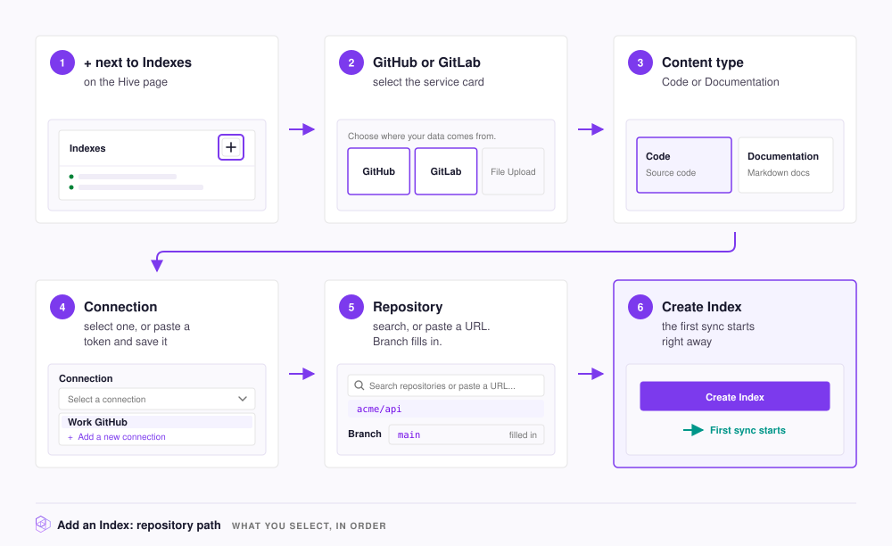

# Connect GitHub or GitLab

Create a token, save it as a connection, select the repository, and then create the [Index](../../concepts/glossary.md#index) in your [Hive](../../concepts/glossary.md#hive). The first sync starts automatically.

<figure><figcaption></figcaption></figure>

## Create a token

Create a personal access token (PAT) on GitHub or GitLab with the scopes in the following tabs. You can also use an SSH key. Scopes are the permissions the token grants. The connection form's **Create a PAT** link opens the provider's token page with the token name and scopes filled in.



Create a classic personal access token with the `repo` scope. The token starts with `ghp_`.

```text
https://github.com/settings/tokens/new?scopes=repo&description=NeoHive
```



Create a personal access token with the `read_api` and `read_repository` scopes. The token starts with `glpat-`.

```text
https://gitlab.com/-/user_settings/personal_access_tokens?name=NeoHive&scopes=read_api,read_repository
```

If you host your own GitLab, first enter your instance's address in **GitLab Base URL**. The **Create a PAT** link then opens your own instance. If you use `gitlab.com`, leave the field blank.



In the connection form, select the **SSH** tab and paste an SSH private key into **SSH Private Key**. The key needs read access to the repository and no passphrase, because NeoHive cannot enter one. For example, you can use a deploy key, which is a key added to a single repository. To create a deploy key, see GitHub's [Managing deploy keys](https://docs.github.com/en/authentication/connecting-to-github-with-ssh/managing-deploy-keys) or GitLab's [Deploy keys](https://docs.gitlab.com/user/project/deploy_keys/).



## Create the Index

To create the Index, do the following:

1. In the dashboard, open your Hive.
2. Next to **Indexes**, select **+**.
3. Select **GitHub** or **GitLab**.
4. Under **Content type**, select **Code**, or **Documentation** for a repository of docs.
5. Under **Connection**, select a saved connection. To add one, select **Add a new connection**, and then do the following. If you have no saved connection, the form is already open.
    1. Enter a **Name**, such as `Work GitHub`.
    2. Paste the token or SSH key you created in [Create a token](#create-a-token). For a token, use **Personal Access Token** on the **PAT** tab. For an SSH key, select the **SSH** tab and use **SSH Private Key**.
    3. Select **Save connection**. NeoHive checks the token or key with the provider and does not save one that the provider rejects. If you already saved the same token or account, NeoHive warns you and offers **Add anyway**.
6. Under **Repository**, select the repository from the list, or paste its URL into **Search repositories or paste a URL...**. If the list does not show a pasted repository, select its **Use** row, such as **Use acme/api**.
7. Check **Index name** and **Branch**. NeoHive fills both in from the repository. The Index name must be unique in the Hive. To use another branch, select it from the list.
8. Select **Create Index**.

NeoHive opens the new Index page and starts the first sync. The page header shows the progress.


**Check:** Open the Index's **Sync Settings** tab. **Sync history** shows the first run. When the run finishes, its status reads `success`. If it reads `partial` or `failed`, see [Repository sync issues](../../troubleshooting/sync.md).


## After you create the Index

Optional: Open the **Index Info** tab, and then fill in **Description**. Your agent reads the description through `list_indexes` to pick the right Index, so name what the repository covers. For example, write `Billing and payments services: Stripe webhooks, retries, nightly reconciliation` rather than `repo index`.

A Documentation Index indexes every file that its filters allow, not only docs. To keep it to markdown, add `**/*.md` to its **Allowlist**. See [Choose which files are included](file-patterns.md).

To change the **Branch** or **Connection** later, use the **Sync Settings** tab.

Optional: to match code more closely, or to use less memory, change the Index's embedding model. To choose a model that fits your machine, see [Embedding models](../../admin/embedding-models.md).

To add, check, or replace a connection without creating an Index, use the **Data Sources** page. See [Data sources and credentials](../../admin/data-sources.md).
