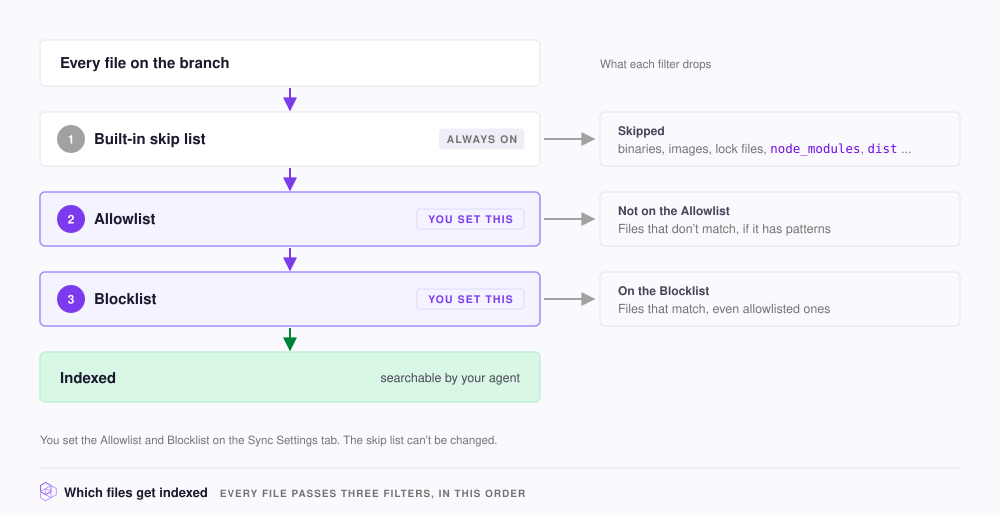

# Choose which files are included

By default, NeoHive indexes every file on the branch except binaries, lock files, and build folders such as `node_modules` and `dist`. Generated code and test fixtures are indexed too, so they show up in your agent's results next to the code that answers the question. To leave them out, add them to the **Blocklist**. To index only some folders, use the **Allowlist**.

<figure><figcaption></figcaption></figure>

## When to use which

| You want to | Use |
|---|---|
| Include the whole repository but leave out generated code, fixtures, or snapshots | **Blocklist** only |
| Include only one part, such as `src/**` and `docs/**` | **Allowlist** only |
| Include only one part but leave out its tests | Both |
| Limit a [Documentation Index](../../concepts/glossary.md#documentation-index) to docs | **Allowlist** with `**/*.md` |

A typical Blocklist looks like this:

```text
**/__fixtures__/**
**/*.snap
docs/generated/**
```

Each pattern matches paths from the repository root, so write `**/*.snap` rather than `*.snap` to match the files in every folder. For the full syntax, see [File pattern syntax](../../reference/file-patterns.md).

## Set the patterns


To get a first draft of the patterns, click **Copy AI prompt** on the **Sync Settings** tab, paste the prompt into your agent, and describe your repository. Your agent replies with patterns for both lists.


To set the patterns, do the following:

1. Open the Index's **Sync Settings** tab. **File filters** is under **Configuration**.
2. Enter one pattern per line in **Allowlist**, **Blocklist**, or both.
3. Click **Save settings**.
4. To apply the new patterns, click **Trigger sync** at the top of the page. Saving does not start a sync.
5. If the **Sync Warning** dialog opens, click **I Understand**.

After a pattern change, the sync reads the whole repository again. NeoHive removes the files that the new patterns leave out and adds the files those patterns now include.

If your agent cannot find a file, check both lists first, because a pattern might filter the file out.
