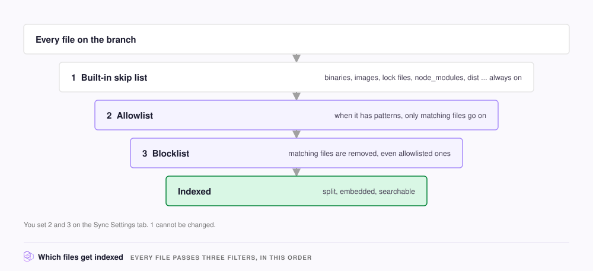

# Choose which files are included

Set an **Allowlist** and a **Blocklist** so that the [Index](../../concepts/glossary.md#index) holds the files that answer questions, and leaves out generated code and test fixtures (sample data for tests). An Index is one store of searchable context inside a [Hive](../../concepts/glossary.md#hive), the workspace your agent connects to. For more terms, see the [NeoHive glossary](../../concepts/glossary.md).

<figure><figcaption></figcaption></figure>

## When to use which

| You want to | Use |
|---|---|
| Include the whole repository but leave out generated code, fixtures, or snapshots | **Blocklist** only |
| Include only one part, such as `src/**` and `docs/**` | **Allowlist** only |
| Include only one part but leave out its tests | Both |
| Limit a [Documentation Index](../../concepts/glossary.md#documentation-index) to docs | **Allowlist** with `**/*.md` |

A typical Blocklist looks like this:

```text
**/__fixtures__/**
**/*.snap
docs/generated/**
```

Write one glob pattern (a file path with wildcards) per line. Each pattern matches the file's path from the repository root. A single `*` does not match across a `/`, so write `**/*.snap` rather than `*.snap`. For wildcards, braces, and more examples, see [File pattern syntax](../../reference/file-patterns.md).

## Set the patterns

To set the patterns, do the following:



## Open the filters

Open the Index's **Sync Settings** tab. **File filters** is under **Configuration**.



## Optional: draft the patterns with your agent

To get a first draft of the patterns, do the following:

1. Select **Copy AI prompt**.
2. Paste the prompt into your agent.
3. Describe your repository to your agent.



## Enter the patterns

Type one pattern per line into **Allowlist**, **Blocklist**, or both.



## Save the settings

Select **Save settings**.



## Sync the Index

Saving does not start a sync, so start one now to apply the new patterns:

1. At the top of the page, select **Trigger sync**.
2. If the **Sync Warning** dialog opens, select **I Understand**.

This sync reads the whole repository again. It removes the files that the new patterns leave out, and adds the files that they now include.



If your agent cannot find a file, check both lists first, because a pattern might filter the file out.
