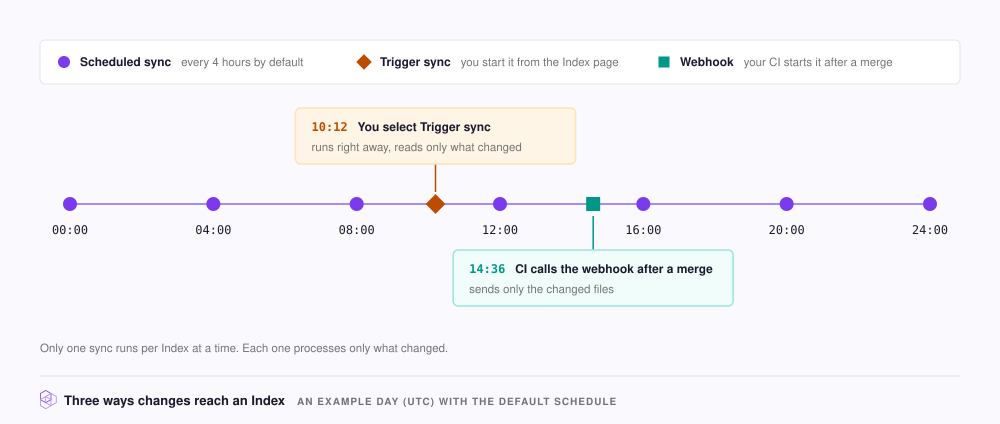

# Keep a repository up to date

A [Code](../../concepts/glossary.md#code-index) or [Documentation Index](../../concepts/glossary.md#documentation-index) stays up to date by syncing with its repository on a schedule. You choose the schedule, and you can select **Trigger sync** to index a change right away. When something looks wrong, **Sync history** shows what each sync did.

<figure><figcaption></figcaption></figure>

Each sync reads only what changed since the last indexed commit. NeoHive indexes new, modified, and renamed files again, and removes deleted files from the [Index](../../concepts/glossary.md#index).

## Set the schedule

To set the schedule, do the following:

1. Open the Index's **Sync Settings** tab.
2. Under **Configuration**, select a **Sync interval**.
3. Select **Save settings**.

Syncs run at fixed times of day, in UTC. For example, **Every 4 hours** runs at 00:00, 04:00, 08:00, and so on, and **Daily** runs at 00:00.

If your machine is off or asleep when a sync is due, NeoHive runs the sync as soon as NeoHive starts again.

## Choose a sync interval

Pick the interval that matches how often the repository changes. The following table suggests an interval for each case:

| **Sync interval** | Good for |
|---|---|
| **Every 15 minutes**, **Every 30 minutes** | A busy repository where your agent needs changes quickly |
| **Every hour** | Most repositories |
| **Every 4 hours** | The default for an Index you add from the dashboard |
| **Daily** | A repository that rarely changes |

## Sync now

To sync now, do the following:

1. At the top of the Index page, select **Trigger sync**.
2. If the **Sync Warning** dialog opens, select **I Understand**. The dialog says that the sync can slow down the machine.

To stop the dialog from opening each time, select **Don't show this again** before you select **I Understand**.

The page header shows the sync progress and a button to cancel the sync.

If some files fail to index, the rest of the repository still syncs, and NeoHive tries the failed files again on its own. If a file keeps failing, NeoHive leaves that file out until you select **Trigger sync**, and the Index page shows `Some files could not be indexed, the rest synced`. To find out why and fix it, see [Repository sync issues](../../troubleshooting/sync.md).

To index changes right after every merge, your CI pipeline can send the changed files to the webhook refresh endpoint. The webhook works differently from a sync, as [How the webhook differs from a sync](../../reference/webhooks.md#how-the-webhook-differs-from-a-sync) explains.

## Read the sync history

**Sync history** appears at the top of the **Sync Settings** tab and lists the newest run first.

| Column | Tells you |
|---|---|
| **Time**, **Duration** | When the run started and how long it took |
| **Status** | `running`, `success`, `failed`, or `cancelled`. `partial`, shown in amber, means that some files failed |
| **Files** | How many files changed, such as `+12A / ~3M / -1D / ↻2R`: **A** added, **M** modified, **D** deleted, **R** renamed. A type with no changes is left out |
| **Progress**, **Chunks** | Files done out of the total, and chunks added or removed |
| **Commit Range** | The commits between the previous run and this one |
| **Error** | What went wrong. Select the error to read the full message |

For runs that keep failing, see [Repository sync issues](../../troubleshooting/sync.md).

## If the branch is renamed

If someone renames the branch, for example from `master` to `main`, the sync usually follows the new name on its own. If it cannot, a banner on the Index page shows `A synced branch is no longer on the remote`, and everything indexed so far stays searchable. To sync the renamed branch, do one of the following:

* In the banner, under **Pick a branch to sync instead**, select the new branch, and then select **Sync this branch**.
* On the **Sync Settings** tab, select the new branch in **Branch**, and then select **Save settings**.

Either way, NeoHive starts a sync of the new branch.
