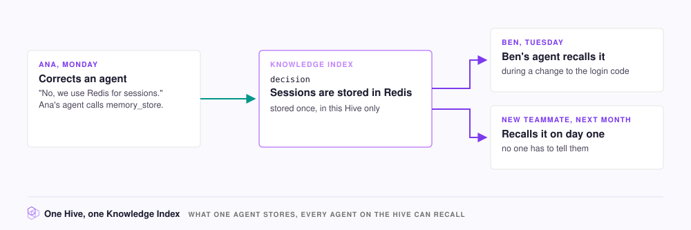

# Capture team knowledge

Every [Hive](../concepts/glossary.md#hive) has a [Knowledge Index](../concepts/glossary.md#knowledge-index), which holds what your team has learned: conventions, decisions and their reasons, problems to watch for, and corrections. When one person's agent stores a [Memory](../concepts/glossary.md#memory) in the Knowledge Index, every agent on the Hive can recall that Memory.

<figure><figcaption></figcaption></figure>

NeoHive creates the Knowledge Index with the Hive. Your agents write to the Knowledge Index, so you have nothing to set up. You cannot change the settings of the Knowledge Index, or share, move, or delete the Knowledge Index.

## How Memories get stored

| Way in | What happens |
|---|---|
| You ask | Say `Remember that the payments API requires idempotency keys on all POST requests.` |
| Your agent notices | When you correct your agent or agree on a convention, the agent stores the point on its own. |
| End of session | Run `/neohive:capture-session-learnings` in Claude Code, or the `capture-session-learnings` skill in Cursor or Codex. The skill stores up to five learnings from the conversation. In an app with no NeoHive plugin, ask your agent to remember each point instead. |
| Existing rules files | Import `CLAUDE.md`, `AGENTS.md`, and rules folders once. See [Import rules from CLAUDE.md and AGENTS.md](migrate.md). |

Each way ends with your agent calling `memory_store`. Every Memory goes into the Knowledge Index of the Hive your agent is connected to. Your agent also gives each Memory a type, such as `directive`, `convention`, or `decision`. For all the types, see [Memory types](../reference/memory-types.md).

To see what your team's agents stored recently, check **Recent learnings** on the Hive page. To open the Knowledge Index, select **Knowledge** under **Indexes**.

## Who can recall your team's Memories

Each Hive's Knowledge Index belongs to that Hive only:

- Everyone who connects an agent to the Hive shares one Knowledge Index.
- A teammate who joins later starts with everything the team has stored.
- Agents connected to a different Hive cannot recall this Hive's Memories.
- Two Hives that use the same [Shared Index](../concepts/glossary.md#shared-index) still keep separate Knowledge Indexes.

For this reason, [What to add, and where](what-to-add.md) suggests one Hive per product. To control who can reach NeoHive, see [Access and sharing](../admin/access.md).

## Correct what goes stale

When a Memory is out of date, tell your agent. Your agent stores the new fact and deactivates the old Memory, so recall stops returning it. For what to say, see [Say "out of date" when a fact changes](../results/teach.md#say-out-of-date-when-a-fact-changes).

Write each Memory so that a reader with no background can understand it. Name the service, the rule, and the reason. For more on phrasing, see [Teach your agent as you work](../results/teach.md).
