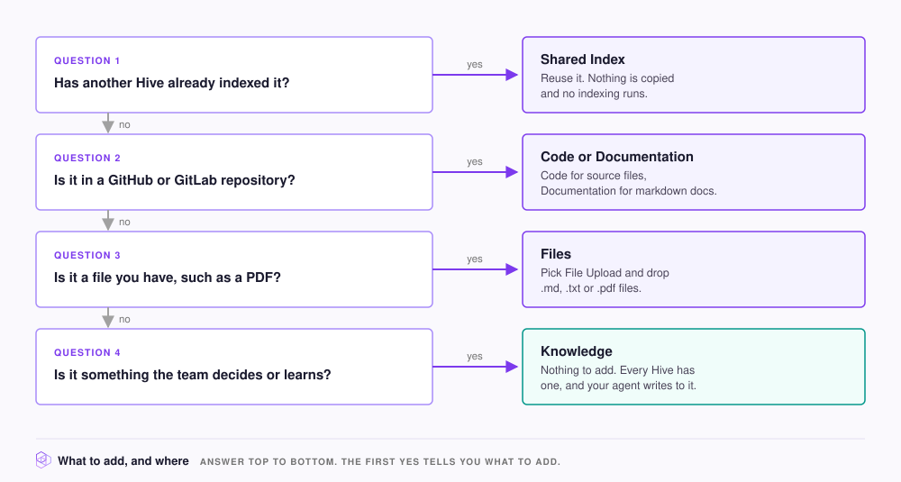

# What to add, and where

NeoHive can hold your source code, your docs, files such as PDFs and specs, and what your team learns. Each kind of content goes in its own kind of [Index](../concepts/glossary.md#index), a searchable store inside NeoHive. Your Indexes live in a [Hive](../concepts/glossary.md#hive), the workspace your agent connects to.

This page shows which Index fits each kind of content, and when content needs a Hive of its own. Read it before you first add content, and again when you plan NeoHive for a new product or team.

<figure><figcaption></figcaption></figure>

## Pick the Index

To open the **Add an Index** dialog, do the following:

1. Open your Hive in the dashboard at `http://localhost:3577`.
2. Select **+** next to **Indexes**.

The **Add an Index** dialog asks where your data comes from.

| Your content | In the dialog | Index you get |
|---|---|---|
| Source code in a repository | **GitHub** or **GitLab**, then **Code** | A [Code Index](../concepts/glossary.md#code-index), kept in sync with the branch |
| Markdown docs in a repository | **GitHub** or **GitLab**, then **Documentation** | A [Documentation Index](../concepts/glossary.md#documentation-index), kept in sync with the branch |
| Documents outside git, such as specs, runbooks, PDFs, or Word files | **File Upload** | A [Files Index](../concepts/glossary.md#files-index), filled by uploading |
| An Index another Hive already set up | **Shared Index**, under **or reuse an existing Index** | The same Index, searchable from your Hive with no copy and no wait for indexing |
| Conventions and decisions your team makes | Nothing to add | The [Knowledge Index](../concepts/glossary.md#knowledge-index), created with every Hive |

A Documentation Index works the same way as a Code Index. Both index every file that their filters allow, not only markdown. To keep a Documentation Index to markdown, add `**/*.md` to its **Allowlist**. [Choose which files are included](repositories/file-patterns.md) shows how. To add either kind, see [Add a code repository](repositories/README.md).


Your agent searches every Index in the Hive at once, or picks a single Index by its name and description. On each Index's **Index Info** tab, write a description that names the services, domains, and languages the Index covers.


## Decide how many Hives

Each Hive has its own [MCP](../concepts/glossary.md#mcp) endpoint, the address your agent connects to. Each Hive also has its own Knowledge Index, so what your agent learns in one Hive stays in that Hive.

| Situation | Do this |
|---|---|
| One product, one repository | One Hive |
| One product across several repositories | One Hive, one Code Index per repository |
| Unrelated products or teams | A separate Hive for each, so results from one codebase do not outrank results from the other |
| A library several products use | Index the library in one Hive. Then add that Index to the other Hives as a **Shared Index**. |

A [Shared Index](../concepts/glossary.md#shared-index) is one Index that several Hives search, not a copy. For what a Shared Index is and what each Hive can change, see [Shared Index](../concepts/hives-indexes-memories.md#shared-index).
