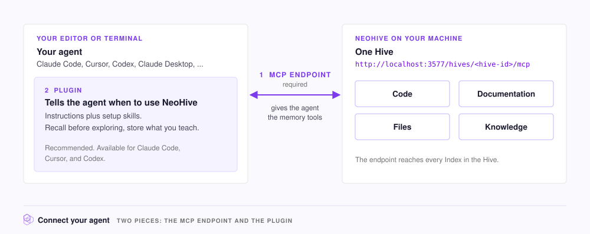

# Connect your agent

Every agent connects to a [Hive](../../concepts/glossary.md#hive) through the Hive's [MCP](../../concepts/glossary.md#mcp) endpoint. The endpoint is a web address, and every agent uses the same one. Claude Code, Cursor, and Codex also get a NeoHive plugin, which tells each agent when to use NeoHive. The following diagram shows how the endpoint and the plugin fit together:

<figure><figcaption></figcaption></figure>

The following table lists the page for each agent and what you set up on it:

| Agent | Page | What you set up |
|---|---|---|
| **Claude Code** | [Claude Code](claude-code.md) | `claude mcp add`, then the NeoHive plugin |
| **Cursor** | [Cursor](cursor.md) | `.cursor/mcp.json`, then the NeoHive plugin |
| **Codex** | [Codex](codex.md) | `~/.codex/config.toml`, then the NeoHive plugin |
| **ChatGPT** | [ChatGPT](chatgpt.md) | A custom MCP server in the ChatGPT desktop app |
| **Claude Desktop** or any other MCP app | [Claude Desktop and other MCP apps](desktop-apps.md) | The endpoint, or `mcp-remote` for apps that only run local commands |

## Tell your agent to use NeoHive

A NeoHive plugin sets up the following instructions for you, either from its own rules file or through its `getting-started` skill. Your agent's page says which. If your agent has no plugin, paste the instructions into your agent's rules file, such as `CLAUDE.md` or `AGENTS.md`, or into its system prompt. Then adjust the instructions to match what your team wants to keep:

```text
## NeoHive

- At the start of every session, call `memory_context` with a short description of the task, for example "adding rate limits to the Express gateway". It loads the conventions and decisions that apply.
- Before reading many files to learn how something works, call `memory_recall` with specific terms, for example "payment retry handler". The indexed code often answers it directly. If it does not, read the files that `memory_recall` returns.
- When I correct you, set a convention, or point out a gotcha, call `memory_store`. Write one self-contained statement with the terms a later search would use and the reason behind it.
- If more than one Hive is connected and you are unsure which one a Memory belongs in, ask before storing.
```
