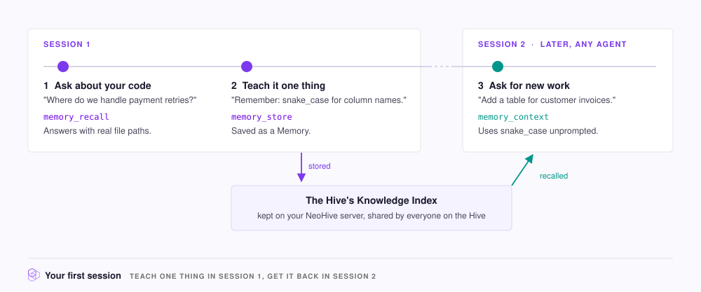

# Your first session

Three prompts are enough to see what NeoHive changes. Your agent answers a question from your own code and saves a convention you teach it. In a new session, the agent then uses that convention without you repeating it. The following diagram shows the three prompts across two sessions:

<figure><figcaption></figcaption></figure>

Before you start, you need an agent connected to a [Hive](../concepts/glossary.md#hive), your team's NeoHive workspace. The Hive also needs a **Code** [Index](../concepts/glossary.md#code-index) (the searchable copy of a repository) whose first sync has finished. For more information about connecting an agent, see [Connect your agent](connect/README.md).



## Ask about your code

Ask your agent a question that only your repository can answer:

```text
Where do we handle payment retries?
```

Your agent calls `memory_recall` and answers from the indexed code, with real file paths. You don't paste files into the chat.



## Teach your agent one thing

Tell your agent a convention that it can't work out from the code:

```text
Remember that we always use snake_case for database column names.
```

The agent calls `memory_store`, which saves the convention as a [Memory](../concepts/glossary.md#memory) in the Hive's **Knowledge** [Index](../concepts/glossary.md#knowledge-index).



## See the convention come back

Close the session and start a new one. Ask for work that the convention applies to:

```text
Add a table for customer invoices.
```

Your agent calls `memory_context` or `memory_recall`, gets the convention back, and uses snake_case without you asking. If your agent has a NeoHive plugin, the agent loads relevant Memories at the start of the task on its own.



The Memory belongs to the Hive, not to your agent. A teammate who connects Cursor or Codex to the same Hive gets the same convention back.


If the agent answers without calling a NeoHive tool, send the agent the following prompt:

```text
Check NeoHive before answering.
```

To make the agent check NeoHive by default, add the rules from [Tell your agent to use NeoHive](connect/README.md#tell-your-agent-to-use-neohive).

