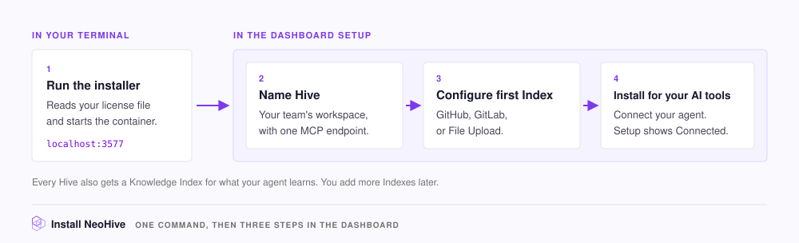

# Install NeoHive

NeoHive runs in a Docker container on a machine you control: your own computer or a server your team shares. You install NeoHive once on that machine, and your coding agent then connects to it there. The installation has three steps. Each step ends with a check, so you know the step worked before you move on. When you finish, your agent answers questions from your own code. The following diagram shows the whole flow:

<figure><figcaption></figcaption></figure>

Before you start, you need the following:

* Docker 20 or later, installed and running on Linux, macOS, or Windows with WSL2.
* Port `3577` free on the machine.
* A NeoHive license file (`license.key` or `license.json`) from the [NeoHive team](https://www.neohive.ai/download/). For more information about license files, see [Licensing](../admin/licensing.md).



## Install

The installer reads your license file, and then starts NeoHive in a Docker container named `neohive`. If the installer can't find the license file, it asks for the path. To install NeoHive, run the following command from the folder that holds your license file:

```bash
bash <(curl -fsSL https://raw.githubusercontent.com/NeoHiveAI/install/main/install.sh)
```

When the installer finishes, it prints two dashboard addresses: `On this machine` and `From another host`. On a shared server, use the `From another host` address.

<details>

<summary>Optional: set the license file path, use another port, or force the CPU backend</summary>

To give the installer the license file path at the start, run the following command:

```bash
bash <(curl -fsSL https://raw.githubusercontent.com/NeoHiveAI/install/main/install.sh) \
  --license-file /path/to/license.key
```

You can also set `NEOHIVE_LICENSE_FILE=/path/to/license.key` before the command. The result is the same.

If port `3577` is already in use, set `NEOHIVE_PORT=3600` (or any free port) before the command. Then use that port wherever these docs say `3577`.

The installer looks for a GPU that supports CUDA, ROCm, or Vulkan, and uses the CPU if it finds none. On an arm64 machine, including an Apple Silicon Mac, the installer skips that search and always uses the CPU backend. An Apple Silicon Mac also gets a small native worker that runs on the Metal GPU. For more information about how the installer picks a backend, see [GPU and CPU](../admin/gpu-cpu.md). If the backend that the installer picks fails, run the installer again with the CPU backend:

```bash
NEOHIVE_BACKEND=cpu \
  bash <(curl -fsSL https://raw.githubusercontent.com/NeoHiveAI/install/main/install.sh)
```

</details>


**Check:** NeoHive is running.

```bash
curl http://localhost:3577/health
```

The reply contains `"status":"ok"`. If the reply doesn't contain `"status":"ok"`, run `docker logs neohive --tail 50` and then see [Common errors](../troubleshooting/common-errors.md).




## Create your Hive

A [Hive](../concepts/glossary.md#hive) is a workspace for one codebase or team. A Hive holds [Indexes](../concepts/glossary.md#index), the stores for your code, documents, files, and [Memories](../concepts/glossary.md#memory). To create your Hive, do the following:

1. Open the dashboard.
2. Read and accept the license.
3. Read through the welcome screens, and then click **Start setup**.
4. In **Name Hive**, enter a name for your Hive.
5. In **Configure first Index**, under **Where does your data live?**, select the first source for the Hive, and then fill in its details.

The following table shows what you can add from each source and what you need for it:

| Source | Content you can select | What you need |
|---|---|---|
| **GitHub** | **Code** or **Documentation** from a repository | A GitHub personal access token |
| **GitLab** | **Code** or **Documentation** from a repository | A GitLab personal access token |
| **File Upload** | Markdown, text, and PDF files | The files |

A GitHub or GitLab token needs the right scopes, and an uploaded file needs a supported type and size. For more information about scopes, see [Add a connection](../admin/data-sources.md#add-a-connection), and for file types and size limits, see [Supported file types](../reference/file-types.md).

Besides the Index you create here, NeoHive gives every Hive a **Knowledge** [Index](../concepts/glossary.md#knowledge-index), which stores the Memories your agent saves. You can add more Indexes later from the Hive page. For more information about which Indexes to add, see [What to add, and where](../context/what-to-add.md).


**Check:** the Index is ready.

Open the Index from the Hive page. For a repository Index, **Sync history** shows that the first sync finished. If the sync failed, see [Repository sync issues](../troubleshooting/sync.md).




## Connect your agent

The last setup step, **Install for your AI tools**, shows the commands that connect your agent. The first command registers the Hive as an [MCP](../concepts/glossary.md#mcp) server, so your agent can call NeoHive's tools. If you need the commands again later, the **Install Instructions** panel on the Hive page shows the same ones. To connect Claude Code, do the following:

1. In your terminal, go to your project's root folder.
2. Run the first command. The command looks like this:

   ```bash
   claude mcp add <name> '<hive-url>' \
     --scope project \
     --transport http \
     --header 'x-mcp-client: claude-code'
   ```

   The `--scope project` flag saves the Hive in that folder's `.mcp.json`, where the plugin's automatic recall looks for it. For more information about why the scope matters, see [Claude Code](connect/claude-code.md).
3. Start Claude Code in the project.
4. When Claude Code asks, approve the NeoHive server. Claude Code doesn't connect to the Hive until you approve the server. After Claude Code connects, setup shows **Connected**.
5. Run the remaining commands inside Claude Code:

   ```text
   /plugin marketplace add NeoHiveAI/NeoHiveClaude
   /plugin install neohive@neohive-claude
   /reload-plugins
   /neohive:getting-started
   ```

To connect a different agent, see [Cursor](connect/cursor.md), [Codex](connect/codex.md), or [Claude Desktop and other MCP apps](connect/desktop-apps.md).


**Check:** your agent answers from your content.

Ask your agent a question that only your content can answer, such as `How does the authentication middleware work?`

The agent calls `memory_recall` and cites real paths from your repository or files. If the `memory_recall` tool is missing, see [Agent can't connect](../troubleshooting/connection.md). If the answer is vague, see [Recall isn't finding what I need](../troubleshooting/recall.md).




## Next step

Your agent is connected, so you can skip the pages for each agent. Continue with [Your first session](first-session.md).
