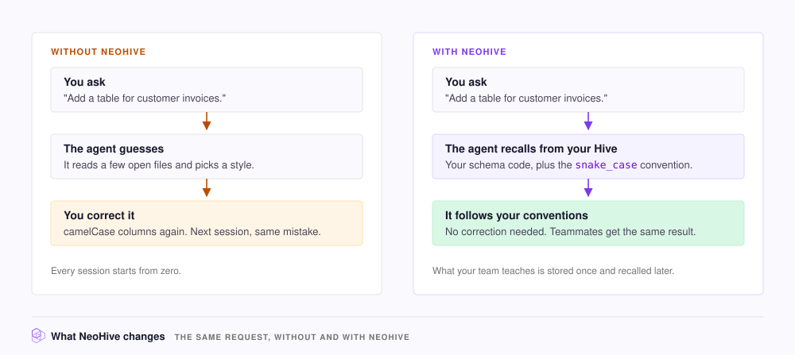
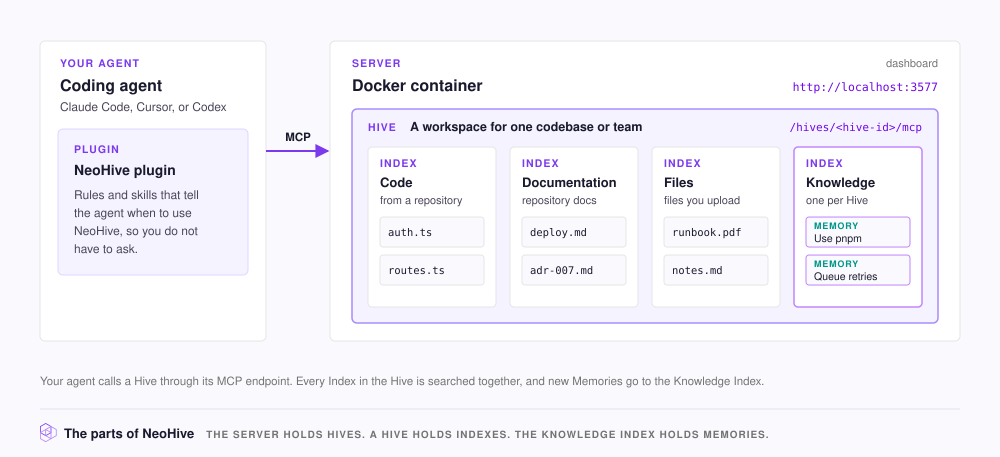

# What is NeoHive?

NeoHive is a self-hosted memory that your team's coding agents share, such as Claude Code, Cursor, and Codex. NeoHive is not an agent itself. It gives your agents your code and your team's knowledge, from a server you run yourself.

## The problem it solves

A coding agent starts every session with no knowledge of your project. It does not know how your code is organized, which conventions your team follows, or what you told it yesterday, so you explain the same things again and correct the same mistakes.

## What changes with NeoHive

* **Your code is searchable.** NeoHive copies your repositories and documents into [Indexes](../concepts/glossary.md#index). The agent finds code by what it does, not by its file name.
* **Lessons stick.** What your team teaches the agent, such as a convention or a bug fix, is stored as a [Memory](../concepts/glossary.md#memory) in your [Hive](../concepts/glossary.md#hive).
* **Only what the task needs.** The agent asks NeoHive through [MCP](../concepts/glossary.md#mcp) and gets back the matching parts, not a whole context file. More of the agent's context window is left for your work.
* **Everything stays with you.** NeoHive runs in a Docker container on your machine or a shared server, and your code, documents, and Memories stay there. The same container serves a dashboard, where you manage your Hives and their content in your browser. See [What stays on your machine](../security/local-only.md).

<figure><figcaption></figcaption></figure>

## The parts

| Part | What it is |
|---|---|
| **Server** | A Docker container on your machine or a shared server. The dashboard runs at `http://localhost:3577`. |
| **Hive** | A workspace for one codebase or team. Each Hive has one MCP endpoint that agents connect to. |
| **Index** | A searchable store inside a Hive. Each Index holds one kind of content, such as your code, your docs, or your team's Memories. |
| **Memory** | One lesson your team teaches the agent, such as a convention, a decision, or the fix for a bug. Any agent connected to the Hive can use it in a later session. |
| **Plugin** | Rules and skills for Claude Code, Cursor, or Codex. The plugin tells the agent when to use NeoHive, so you do not have to ask. |

<figure><figcaption></figcaption></figure>

For the full explanation of Hives, Indexes, and Memories, see [Hives, Indexes, and Memories](../concepts/hives-indexes-memories.md). [How NeoHive works](../concepts/how-it-works.md) shows how the parts fit together.

## Who it is for

| You are | What NeoHive gives you |
|---|---|
| **A team** | One shared Hive. A convention one person teaches comes back for every teammate's agent, whichever tool they use. New joiners get it on day one. See [Team workflows](../results/team-workflows.md). |
| **A developer in an unfamiliar codebase** | An agent that answers from the code instead of guessing, and stops repeating the mistakes you already corrected. |
| **Working alone** | Run NeoHive on your own machine. Your agent remembers your project from one session to the next. |
| **Not a developer** | Claude Desktop and any other MCP app connect to the same Hive. One person sets up the server, everyone else connects. See [Connect your agent](connect/README.md). |
