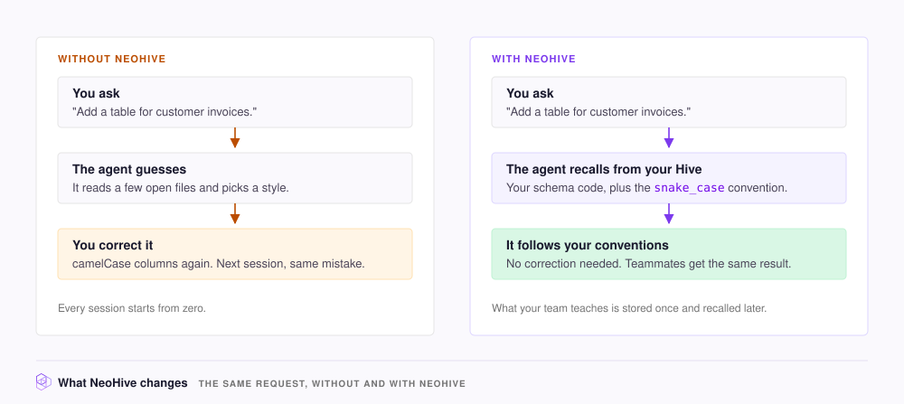
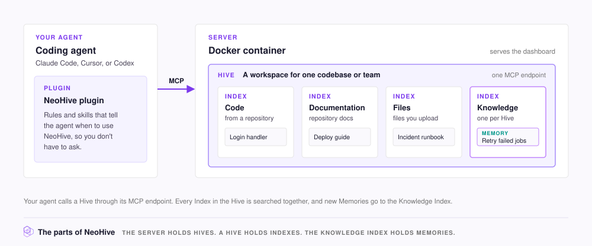

# What is NeoHive?

NeoHive is a self-hosted memory that your team's coding agents, such as Claude Code, Cursor, and Codex, share. NeoHive isn't an agent itself. Instead, it gives your agents your code and your team's knowledge, from a server you run yourself.

## The problem it solves

Each developer on a team teaches their own coding agent, so a correction that one person makes doesn't reach a teammate's agent. Every agent also starts each session without your project's context: how your code is organized, which conventions your team follows, what you told it yesterday, or why your team made a decision.

You explain the same things in every session and correct the same mistakes. What your agents need is context about your project that lasts between sessions and that your whole team shares.

## What changes with NeoHive

NeoHive keeps that context in a [Hive](../concepts/glossary.md#hive), a workspace for one codebase or team, and gives it to your agent in the following ways:

* **Your code is searchable.** NeoHive copies your repositories and documents into [Indexes](../concepts/glossary.md#index), the searchable stores inside a Hive. The agent then finds code by what it does, not by its file name.
* **Notes stick.** What your team teaches the agent goes into the Hive too, as a [Memory](../concepts/glossary.md#memory). That note can be a convention, a bug fix, or the reason behind a decision.
* **Only what the task needs.** When the agent needs context, it asks NeoHive through [MCP](../concepts/glossary.md#mcp) and gets back only the parts that match. The agent doesn't load a whole context file of thousands of lines. That leaves more of its context window free for your actual work.
* **Your content stays with you.** You run NeoHive yourself, so your code, documents, and Memories stay on the machine it runs on. For more information about what stays on that machine and how the parts fit together, see [What stays on your machine](../security/local-only.md) and [How NeoHive works](../concepts/how-it-works.md).

The following diagram compares an agent without NeoHive and an agent with it:

<figure><figcaption></figcaption></figure>

## The parts

NeoHive is made of the following parts:

| Part | What it is |
|---|---|
| **Server** | A Docker container on your machine or a shared server. The dashboard runs at `http://localhost:3577` by default. |
| **Hive** | A workspace for one codebase or team. Each Hive has one MCP endpoint that agents connect to. |
| **Index** | A searchable store inside a Hive. Each Index holds one kind of content, such as your code, your docs, or your team's Memories. |
| **Memory** | One note that your agent saves from what your team teaches it, such as a convention, a decision, or the fix for a bug. NeoHive keeps each Memory, so any agent connected to the Hive can use the note in a later session. |
| **Plugin** | Rules and skills for Claude Code, Cursor, or Codex. The plugin tells the agent when to use NeoHive, so you don't have to ask. |

The following diagram shows how the parts nest:

<figure><figcaption></figcaption></figure>

For more information about Hives, Indexes, Memories, and the kinds of Index, see [Hives, Indexes, and Memories](../concepts/hives-indexes-memories.md).

## Who NeoHive is for

NeoHive is for anyone who works with an AI agent. The following table shows what NeoHive gives each kind of reader:

| You are | What NeoHive gives you |
|---|---|
| **A team** | NeoHive helps teams most, because everyone connected to the same Hive shares its Memories. A convention that one person teaches comes back for every teammate's agent, whichever tool they use. A teammate who joins later gets that knowledge on their first day. For more information about how teams share Memories, see [Team workflows](../results/team-workflows.md). |
| **A developer in an unfamiliar codebase** | Your agent learns the codebase from NeoHive instead of guessing, so you stop correcting the same mistakes. |
| **A developer working alone** | Run NeoHive on your own machine, and your agent remembers your project from one session to the next. |
| **Not a developer** | You don't need to be a developer to use NeoHive. ChatGPT, Claude Desktop, and any other app that supports MCP can connect to the same Hive. One person sets up the NeoHive server, and everyone else connects their app to it. For more information, see [Connect your agent](connect/README.md). |
