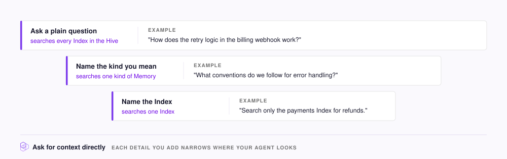

# Ask for context directly

Your agent searches your [Hive](../concepts/glossary.md#hive) on its own when its rules tell it to. You can also ask your agent directly what the Hive knows about a task, from your code and docs to the [Memories](../concepts/glossary.md#memory) your team has taught its agents. Ask before your agent writes any code, so your agent starts from your team's decisions and known problems instead of guessing.

Ask the way you would ask a teammate:

| You want | Ask something like | Your agent calls |
|---|---|---|
| What the team knows before you start | `Before we start, what do we know about the auth flow in the gateway?` | `memory_context` |
| Whether the team has seen a problem before | `Have we hit flaky failures in the batch processor before? What fixed them?` | `memory_recall` |
| The rules for an area | `What conventions do we follow for error handling in the API layer?` | `memory_recall`, limited to conventions |
| How a piece of code works | `How does the retry logic in the billing webhook work?` | `memory_recall`, then reads the files that the results point to |
| Which Indexes your agent can search | `List my NeoHive Indexes.` | `list_indexes` |

## Narrow the ask

By default, your agent searches every [Index](../concepts/glossary.md#index) in the Hive. The more specific your ask, the narrower the search. You can narrow it by the kind of knowledge you want, or to one Index. The following diagram shows three levels, each with an example:

<figure><figcaption></figcaption></figure>

The following table shows what to ask about and what comes back:

| Ask about | What comes back |
|---|---|
| Your team's rules, such as `what must we always do when we call the payments API` | The rules and conventions your team stored |
| Problems seen before, such as `have we hit this timeout before` | Known problems, and the fixes your team found |
| The reason for a choice, such as `why did we choose Redis for sessions` | The decisions your team recorded, with their reasons |
| One Index, such as `search only the payments Index` | Results from that Index only. Your agent finds the Index's ID with `list_indexes`. |

Your agent decides how to narrow the search from your words, so the answer can still include other results. If the first answer does not have what you need, ask again in different words. Two phrasings of the same idea often return different results.
