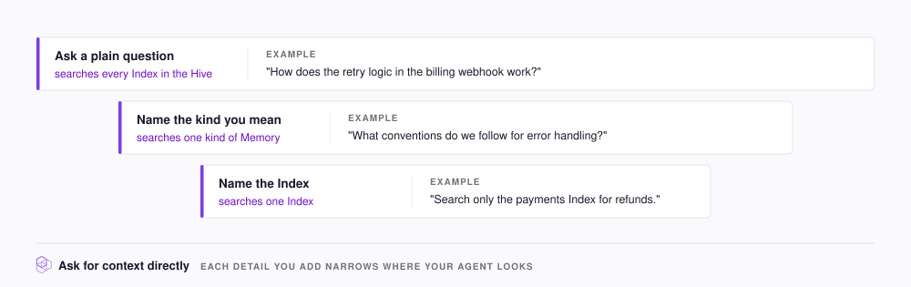

# Ask for context directly

Your agent searches your [Hive](../concepts/glossary.md#hive) on its own when its rules tell it to. You can also ask it directly what the Hive knows: your code, your docs, and the [Memories](../concepts/glossary.md#memory) your team has taught it. Ask before your agent writes any code, and it starts from your team's decisions and known problems instead of guessing.

Ask the way you would ask a teammate:

| You want | Ask something like | Your agent calls |
|---|---|---|
| What the team knows before you start | `Before we start, what do we know about the auth flow in the gateway?` | `memory_context` |
| Whether the team has seen a problem before | `Have we hit flaky failures in the batch processor before? What fixed them?` | `memory_recall` |
| The rules for an area | `What conventions do we follow for error handling in the API layer?` | `memory_recall`, limited to conventions |
| How a piece of code works | `How does the retry logic in the billing webhook work?` | `memory_recall`, then reads the files that the results point to |
| Which Indexes your agent can search | `List my NeoHive indexes.` | `list_indexes` |

## Narrow the ask

By default, your agent searches every [Index](../concepts/glossary.md#index) in the Hive. An Index is one store of context inside a Hive, such as your code or your team's Memories. Each detail you add narrows the search.

<figure><figcaption></figcaption></figure>

| Say | Your agent narrows the search to |
|---|---|
| "conventions", "rules", "what must we always do" | Directives and conventions |
| "have we hit this before", "known gotchas" | Insights and error patterns |
| "why did we choose" | Decisions |
| "search only the payments Index" | One Index. Your agent finds the Index ID with `list_indexes`. |

[Memory types](../reference/memory-types.md) lists every type. If the first answer misses, ask again in different words, because two phrasings of the same idea often return different Memories.
