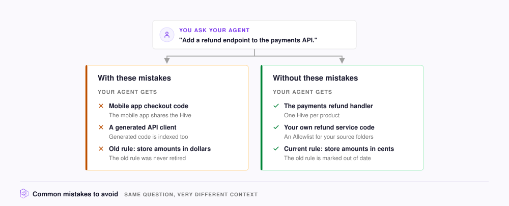

# Common mistakes to avoid

Some setup choices and habits make NeoHive's answers worse without ever showing an error. Your agent still answers, but from the wrong context. Because nothing fails, the mistake can go unnoticed. The following diagram shows one request with and without these mistakes:

<figure><figcaption></figcaption></figure>

## Mistakes and how to fix them

When answers seem off but nothing is broken, find what you notice in the following tables. Each row names one mistake, what you notice, and how to fix it.

### When you set up Hives and Indexes

The following table shows the mistakes you can make during setup:

| Mistake | What you notice | Fix |
|---|---|---|
| **Index with an empty or vague description** | Your agent searches the wrong [Index](../concepts/glossary.md#index), or every Index, when you ask about one area. | On the Index page, fill in **Description** under **Index settings**. Your agent reads the description in `list_indexes`. |
| **Unrelated codebases in one Hive** | Answers include code and conventions from another product. | Give each product its own [Hive](../concepts/glossary.md#hive). To reuse an Index elsewhere, add it to the other Hive as a **Shared Index**. |
| **Indexing everything the defaults allow** | Generated code, snapshot fixtures, and CSV or JSON data fill results that should show your source code. | Set an **Allowlist** for the folders you work in. Then set a **Blocklist** for files to leave out inside those folders. |
| **Wrong [MCP](../concepts/glossary.md#mcp) server name or scope** | In Claude Code, prompts stop adding context automatically. Tool calls still work. | Keep `neohive` in the server name. Add the server with `--scope project` from your project's root folder. For more information, see [What the plugin does automatically](plugin-automation.md). |

### While you work with your agent

The following table shows the mistakes you can make during a session:

| Mistake | What you notice | Fix |
|---|---|---|
| **Never correcting the agent** | The same wrong suggestion comes back in every session. | When your agent is wrong, say what is correct and why. |
| **Stating a new fact without retiring the old one** | Your agent quotes the old rule as often as the new one. | Say "that's out of date" so your agent deactivates the old [Memory](../concepts/glossary.md#memory). For more information, see [Teach your agent as you work](teach.md). |
| **One session across unrelated tasks** | Loaded context fits the task you started with, not the task you are working on now. | Start a new session, or run `/neohive:load-context` with the new task. |
| **Skipping the end-of-session capture** | Your agent never recalls decisions from long sessions. | Run `/neohive:capture-session-learnings` before you close the session. |

## What NeoHive already skips

NeoHive always skips dependency and build folders, lock files, minified bundles, and binary files, so you do not need to block them. For more information about the folders and files NeoHive skips, see [Files in a repository](../reference/file-types.md#files-in-a-repository). To write your own Allowlist and Blocklist patterns, see [Choose which files are included](../context/repositories/file-patterns.md).

To fix an actual error, such as a failed sync or a tool your agent cannot find, see [Common errors](../troubleshooting/common-errors.md) instead.
