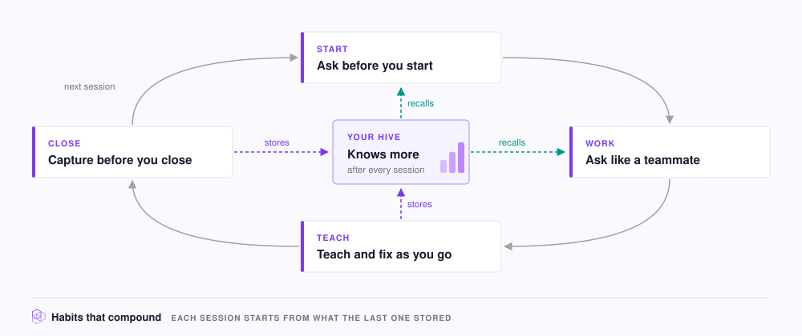

# Habits that compound

Each habit takes a few seconds and adds to what your [Hive](../concepts/glossary.md#hive) knows. A correction you store today comes back in every later session, for you and for every teammate.

<figure><figcaption></figcaption></figure>

1. **Ask before you start.** For example: "What do we already know about the auth flow here?"
2. **Ask like a teammate.** Name the system, so recall matches [Memories](../concepts/glossary.md#memory) that use the same names. See [Write prompts that retrieve well](prompting.md).
3. **Teach as you go.** For example: "Remember that we always use idempotency keys on payment POST requests." See [Teach your agent as you work](teach.md).
4. **Fix out-of-date knowledge.** For example: "That's out of date. We moved off Redis for sessions last month."
5. **Reload when the task changes.** Start a new session, or run `/neohive:load-context` with the new task.
6. **Capture before you close.** Run `/neohive:capture-session-learnings`.

For the whole team, **keep repositories in sync**. Set a **Sync interval** on each [Code](../concepts/glossary.md#code-index) or [Documentation Index](../concepts/glossary.md#documentation-index) so answers match the current code. See [Keep a repository up to date](../context/repositories/sync.md).

## How you know the habits are working

After a few weeks, your agent follows your conventions without reminders. To check, open your Hive in the dashboard and look at **Recent learnings** for what agents stored and **Recent queries** for what they asked.
