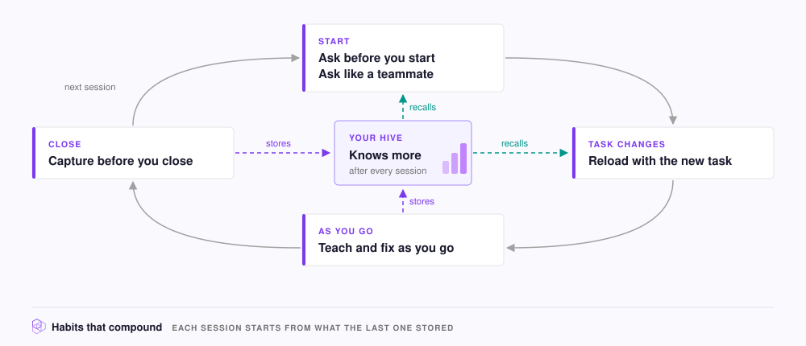

# Habits that compound

Each habit takes a few seconds and adds to what your [Hive](../concepts/glossary.md#hive) knows, or keeps that knowledge correct. The benefit grows over time, which is why the habits compound. A correction you store today can come back in any later session, for you and for every teammate.

Three habits recall from your Hive: asking before you start, asking like a teammate, and reloading when the task changes. Teaching as you go, fixing out-of-date knowledge, and capturing before you close store into the Hive. The following diagram shows that loop through a session:

<figure><figcaption></figcaption></figure>

Each habit is something you say or do while you work with your agent:

1. **Ask before you start.** For example: "What do we already know about the auth flow here?"
2. **Ask like a teammate.** Name the system, so recall matches [Memories](../concepts/glossary.md#memory) that use the same names. For more information, see [Write prompts that retrieve well](prompting.md).
3. **Teach as you go.** For example: "Remember that we always use idempotency keys on payment POST requests." For more information, see [Teach your agent as you work](teach.md).
4. **Fix out-of-date knowledge.** For example: "That's out of date. We moved off Redis for sessions last month."
5. **Reload when the task changes.** Start a new session, or run `/neohive:load-context` with the new task.
6. **Capture before you close.** Run `/neohive:capture-session-learnings`.

For the whole team, **keep repositories in sync**. Set a **Sync interval** on each [Code](../concepts/glossary.md#code-index) or [Documentation Index](../concepts/glossary.md#documentation-index) so answers match the current code. For more information, see [Keep a repository up to date](../context/repositories/sync.md).

## How you know the habits are working

After a few weeks, your agent follows your conventions without reminders. Your agent also stops suggesting patterns your team no longer uses.

To check your progress, do the following:

1. In the dashboard, open your Hive.
2. To see what agents stored, click the **Recent learnings** tab.
3. To see what agents asked, click the **Recent queries** tab.
