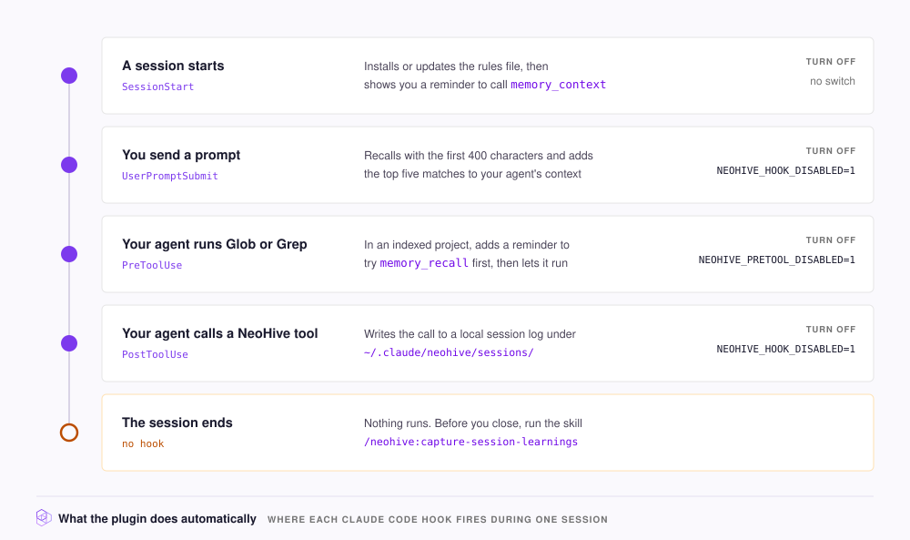

# What the plugin does automatically

The NeoHive plugin is a package for Claude Code, Cursor, or Codex that tells your agent when to use NeoHive. With the plugin, you do not have to ask each time. In Claude Code, the plugin also runs hooks. A hook is a small script that Claude Code starts at a set point in a session. For example, one hook runs when you send a prompt. The Codex and Cursor plugins have no hooks. For what they do, see [In Codex and Cursor](#in-codex-and-cursor).

The hooks run without you doing anything, and most hooks have a switch to turn them off. A few steps, such as saving what your agent learned, are still yours to run.

The following diagram shows each hook in one Claude Code session:

<figure><figcaption></figcaption></figure>

## Claude Code hooks

The following table shows when each hook runs and what it does:

<table><thead><tr><th width="160">Hook</th><th width="170">Runs when</th><th>What it does</th></tr></thead><tbody>
<tr><td><code>SessionStart</code></td><td>A session opens</td><td>Copies the rules file to <code>~/.claude/rules/neohive.md</code> if the file is missing or its version differs from the plugin's copy. The rules file tells your agent to call <code>memory_context</code>. The hook also shows you a reminder in the session. This hook has no off switch.</td></tr>
<tr><td><code>UserPromptSubmit</code></td><td>You send a prompt</td><td>Sends the first 400 characters of the prompt to <code>memory_recall</code>. Then adds the top 5 matches to your agent's context. Turn it off with <code>NEOHIVE_HOOK_DISABLED</code>.</td></tr>
<tr><td><code>PreToolUse</code></td><td>Your agent runs <code>Glob</code> or <code>Grep</code></td><td>Adds a reminder to try <code>memory_recall</code> first. Then lets the search run. Turn it off with <code>NEOHIVE_PRETOOL_DISABLED</code>.</td></tr>
<tr><td><code>PreToolUse</code></td><td>The <code>explore-neohive</code> subagent calls an MCP tool</td><td>Lets the subagent call only <code>memory_recall</code>, <code>memory_context</code>, and <code>list_indexes</code>. This hook has no off switch.</td></tr>
<tr><td><code>PostToolUse</code></td><td>Your agent calls a NeoHive tool</td><td>Records the call in a local log at <code>~/.claude/neohive/sessions/&lt;session-id&gt;.jsonl</code>. Turn it off with <code>NEOHIVE_HOOK_DISABLED</code>.</td></tr>
</tbody></table>

Every hook except `SessionStart` needs `python3` on your `PATH`, and the prompt hook also needs `curl`. Without those tools, the hooks do nothing.

## Turn off a hook

To turn off a hook, do the following:

1. Set the hook's switch to `1`, for example `NEOHIVE_HOOK_DISABLED=1`, in the environment that Claude Code runs in, such as your shell profile.
2. Start a new session.

The hook does not run in the new session. For more information about each switch, see [Environment variables](../reference/environment-variables.md).

## When the prompt recall adds nothing

The prompt hook adds nothing in these cases:

* **The prompt is short.** It is under 10 characters, such as `yes, go`.
* **The prompt is a slash command.** It starts with `/`.
* **The hook finds no NeoHive server.** The hook reads only `.mcp.json` in the current folder and the top level of `~/.claude.json`. In those files, it uses only a server whose name contains `neohive` and that has a `url`.
* **NeoHive answers slowly.** The hook stops waiting after 8 seconds and sends your prompt without extra context.
* **Nothing matches.** Recall finds no matching context.


The prompt hook finds your [Hive](../concepts/glossary.md#hive) through the `.mcp.json` that the **Install Instructions** command writes with `--scope project`. If you add the server with the default local scope, tool calls still work. The hook then adds no context to your prompts. For more information about which scope to use, see [Connect Claude Code](../get-started/connect/claude-code.md).


The hook adds context under `NeoHive auto-context` and cuts it off at 4,000 characters. If NeoHive returns an error, the hook adds `NeoHive auto-context unavailable:` and the error text instead. If `NEOHIVE_TOKEN` is set, the hook sends that token as a bearer token.

## The Glob and Grep reminder

`Glob` and `Grep` are the Claude Code tools that find files by name and search text inside files. The reminder asks your agent to try `memory_recall` first. Recall finds code by what it does, not by its file name.

The reminder appears only when a `.mcp.json` file in the current folder, or in a folder above it, lists a NeoHive server. To block the search instead, set `NEOHIVE_PRETOOL_STRICT=1`. Your agent then sees the reminder as the reason for the block.

## The explore-neohive subagent

The plugin includes one [subagent](../concepts/glossary.md#subagent), named `explore-neohive`. `explore-neohive` searches memory first and reads files only after memory points to them. The plugin's rules tell your agent to use `explore-neohive` instead of the built-in `Explore` subagent for questions like "where is X handled?".

## What you run yourself

No hook runs the following two commands, so you run both commands yourself.

**Save the session's learnings.** Run `/neohive:capture-session-learnings` before you close the session.

**Optional: rewrite each prompt before recall.** To add a second prompt hook, run `/neohive:enable-smart-prompts`. The new hook asks a small model (Haiku by default) to rewrite each prompt into a `memory_recall` query. The default hook also keeps running unless you turn it off.

Smart prompts needs the following:

* The `claude` command-line tool, `python3`, and `curl`.
* The `ANTHROPIC_API_KEY` environment variable. If the key or any tool is missing, the new hook adds nothing.
* An off switch, which you name during setup. The suggested name is `NEOHIVE_SMART_DISABLED`.

For more information about the other plugin commands, see [Slash commands](../reference/slash-commands.md).

## In Codex and Cursor

The Codex and Cursor plugins include no hooks, so nothing runs when a session starts, when you send a prompt, or before a search. Each plugin's rules file tells your agent to call `memory_context` first and to check memory before searching files. In Codex, the rules file is `rules/neohive.md` in the plugin. In Cursor, the rules file is `rules/neohive.mdc`, set to always apply, so it loads in every chat.

In Codex and Cursor, `enable-smart-prompts` writes the helper script but does not register it. At the end of setup, the skill shows how to connect the script to your agent.
