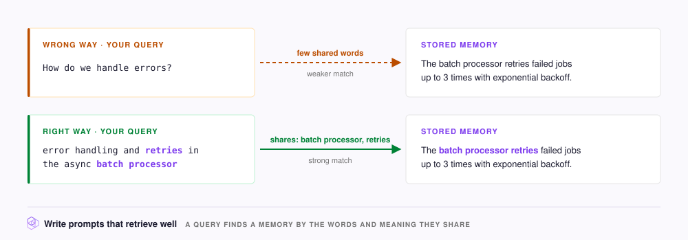

# Write prompts that retrieve well

Recall is how your agent searches your [Hive](../concepts/glossary.md#hive) for context, through `memory_recall` or `memory_context`.

Recall finds a [Memory](../concepts/glossary.md#memory), code, or a document by the words and meaning it shares with your query. A vague question shares few words with anything, so it gets weak matches. Write each prompt and query the way the answer would be written. For more information about how recall finds and ranks results, see [How retrieval works](../concepts/retrieval.md).

The following diagram shows a question and a statement matched against one stored Memory:

<figure><figcaption></figcaption></figure>

The following table shows vague queries and how to rewrite them:

| Instead of | Write | Why it works better |
|---|---|---|
| `How does the batch job handle errors?` | `error handling and retries in the async batch processor` | The rewrite names the system and what "errors" means there, which a matching Memory also mentions. |
| `auth stuff` | `JWT validation and token refresh in the API gateway middleware` | The query names the parts a matching Memory would mention. |
| `duplicate payment prevention` | `idempotency keys on payment POST requests` | Your team calls this idempotency keys, and stored Memories use your team's own words. |
| `ok now fix the thing that drops big docs in search` | `Search indexing worker: it drops documents over 1MB. Fix that next.` | The subject comes first, so a search built from the prompt starts with the system's name. |

## Put the subject first

Your agent builds its searches from what you write, so put the system and the problem first, then the background and instructions. In Claude Code, the plugin also recalls with only the start of each prompt. For more information, see [What the plugin does automatically](plugin-automation.md).

## Ask for several phrasings on important searches

`memory_recall` accepts `queries`, a list of phrasings whose results it merges into one list. When you do not know the words your team uses, ask your agent to search several ways, and name your own topic. For example:

```text
Search memory a few different ways for how we rate-limit the billing API.
```

For more information about the parameters of `memory_recall` and their limits, see [MCP tools](../reference/mcp-tools.md#memory_recall).

## Pick the right tool

Your agent uses two tools to search your Hive:

* `memory_context`, once, at the start of a task, to load the rules and Memories that fit the task.
* `memory_recall`, any time the task needs something specific.

Describe your task as a statement, because your agent passes your words to `memory_context`. For example, `implementing rate limiting for the Express gateway` finds more than `what do we know about the gateway?`.

Both tools search every [Index](../concepts/glossary.md#index) in your Hive unless you pass `index`.

If your agent has no NeoHive plugin, paste the rules in [Tell your agent to use NeoHive](../get-started/connect/README.md#tell-your-agent-to-use-neohive) into its rules file.


To see exactly what your agents searched for, open your Hive in the dashboard and click the **Recent queries** tab.

