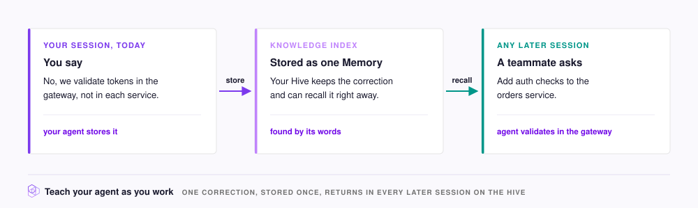

# Teach your agent as you work

Without NeoHive, your agent forgets what you told it once the session ends, so you explain the same things and correct the same mistakes again. With NeoHive, you say it once, in plain words. Your agent stores it as a [Memory](../concepts/glossary.md#memory) in your [Hive](../concepts/glossary.md#hive), and every teammate's agent gets it back in later sessions, whichever tool they use.

Fix it once, and the whole team keeps the fix. This page shows what to say, and how to word a lesson so recall finds it later.

<figure><figcaption></figcaption></figure>

## What to say

Type these to your agent in the chat, in plain words, the way you would tell a teammate. There is no special command.

* **When your agent gets something wrong:**

    Give the right answer and the reason. Your agent saves the correction as a Memory, so it stops repeating the mistake.

    `No, we validate tokens in the gateway, not in each service.`

* **When you make a decision:**

    Say what you chose and why. Your agent saves the decision, so later sessions follow it.

    `Remember that we use Redis for sessions because they are short-lived and need no durability.`

* **When you find a problem your team should avoid:**

    Describe the problem and when it happens. Your agent saves it, so your teammates' agents know to avoid it.

    `Store this: the staging database rejects connections without TLS.`

## Say it when it happens

Correct your agent while the reason is still in the conversation, because the reason is what makes the Memory useful later. The reasoning behind a choice is the first thing a team loses. Before you close a session, run `/neohive:capture-session-learnings` to catch what you missed. It stores at most five Memories per run.

## Name the system, the rule, and the reason

Recall finds a Memory by the words and meaning in it, so a specific correction creates a Memory that recall can find:

| Vague (hard to recall) | Specific (recalled reliably) |
|---|---|
| `We fixed the bug.` | `Retry calls to the billing API with exponential backoff from 500ms, at most 3 attempts. The provider returns 429 with no Retry-After header.` |
| `Don't use the old client.` | `Use the v2 HTTP client in lib/http for all outbound calls. The v1 client has no request timeout and hangs workers.` |

## Say "out of date" when a fact changes

If you state only the new fact, both versions stay active, and your agent can use either one. Say that the old fact is out of date, and your agent calls `memory_forget` on the old Memory and stores the new one:

```text
That's out of date. We moved sessions off Redis last month. Update it.
```

Recall stops returning the old Memory. NeoHive switches it off rather than deleting it.

## Where Memories go

Everything your agent stores goes into your own Hive's [Knowledge Index](../concepts/glossary.md#knowledge-index), and your agents can recall it right away. Your agent never writes to a [Shared Index](../concepts/glossary.md#shared-index), which belongs to another Hive and is read-only from yours.

To see what your agents stored, do the following:

1. In the dashboard, open your Hive.
2. Select the **Recent learnings** tab.

The tab lists the latest Memories your agents stored in the last 7 days.

To import rules your team already keeps in `CLAUDE.md` or `AGENTS.md`, see [Migrate from CLAUDE.md](../context/migrate.md).
