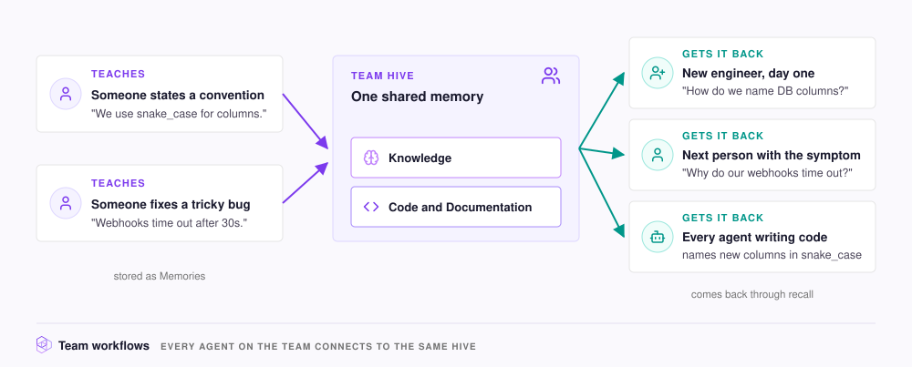

# Team workflows

Without a shared memory, each person teaches their own agent the same things. The next teammate then explains the same convention again. When every agent on the team connects to one [Hive](../concepts/glossary.md#hive), the Hive keeps each note once, as a [Memory](../concepts/glossary.md#memory). Every agent can then recall the Memory, whichever tool the teammate uses.

To share one Hive, each teammate first connects to the team's Hive. Teams then use the Hive in three ways: onboarding, debugging with past fixes, and keeping conventions consistent. The following diagram shows notes going into the Hive and coming back to other agents:

<figure><figcaption></figcaption></figure>

## Connect each person to the team Hive

A Hive has one [MCP](../concepts/glossary.md#mcp) endpoint. Everyone who connects to the endpoint reads the same [Indexes](../concepts/glossary.md#index) and writes to the same [Knowledge Index](../concepts/glossary.md#knowledge-index). For this reason, each teammate connects to the team's Hive instead of creating their own. To connect each teammate's agent, see [Connect your agent](../get-started/connect/README.md). To run one NeoHive instance for a team, see [Access and sharing](../admin/access.md).

## The three workflows

The following table shows each workflow, what someone stored earlier, and what anyone can then ask:

| Workflow | Someone did this earlier | Now anyone can ask |
|---|---|---|
| **Onboard a teammate** | Taught the Hive the team's conventions and decisions | `How do we handle authentication in the API gateway, and why?` |
| **Debug with past fixes** | Stored the symptom, cause, and fix of a bug | `Have we run into flaky failures in the batch processor? What fixed them?` |
| **Keep conventions consistent** | Said `Remember that we use snake_case for all database column names.` | Nobody needs to ask. When your agent loads context for a task, `memory_context` returns the conventions that fit it. |

Each workflow works only after someone has done what the middle column describes, because recall cannot return a fix that nobody stored. When you solve a difficult problem, tell your agent to remember the symptom, the cause, and the fix.


To import rules your team already keeps in `CLAUDE.md` or `AGENTS.md` files, see [Import rules from CLAUDE.md and AGENTS.md](../context/migrate.md).

