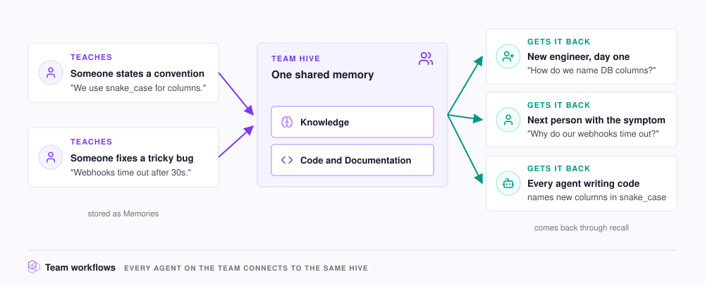

# Team workflows

Without a shared memory, each person teaches their own agent the same things, and the next teammate explains the same convention again. When every agent on the team connects to one [Hive](../concepts/glossary.md#hive), a lesson is stored once, as a [Memory](../concepts/glossary.md#memory). Every agent can then recall it, whichever tool the teammate uses.

This page shows how to connect the team to one Hive, and the three ways teams use it.

<figure><figcaption></figcaption></figure>

## Connect each person to the team Hive

A Hive has one [MCP](../concepts/glossary.md#mcp) endpoint. Everyone who connects to it reads the same [Indexes](../concepts/glossary.md#index) and writes to the same [Knowledge Index](../concepts/glossary.md#knowledge-index), so each teammate connects to the team's Hive instead of creating their own. [Access and sharing](../admin/access.md) explains how to run one NeoHive instance for a team.

## The three workflows

| Workflow | Someone did this earlier | Now anyone can ask |
|---|---|---|
| **Onboard a teammate** | Taught the Hive the team's conventions and decisions | `How do we handle authentication in the API gateway, and why?` |
| **Debug with past fixes** | Stored the symptom, cause, and fix of a bug | `Have we run into flaky failures in the batch processor? What fixed them?` |
| **Keep conventions consistent** | Said `Remember that we use snake_case for all database column names.` | Nobody needs to ask. At session start, `memory_context` returns the conventions that fit the task. |

Each workflow works only after someone has done what the middle column describes, because recall cannot return a fix that nobody stored. When you solve a difficult problem, tell your agent to remember the symptom, the cause, and the fix.

To start the Hive with rules your team already keeps in `CLAUDE.md` or `AGENTS.md` files, see [Migrate from CLAUDE.md](../context/migrate.md).
