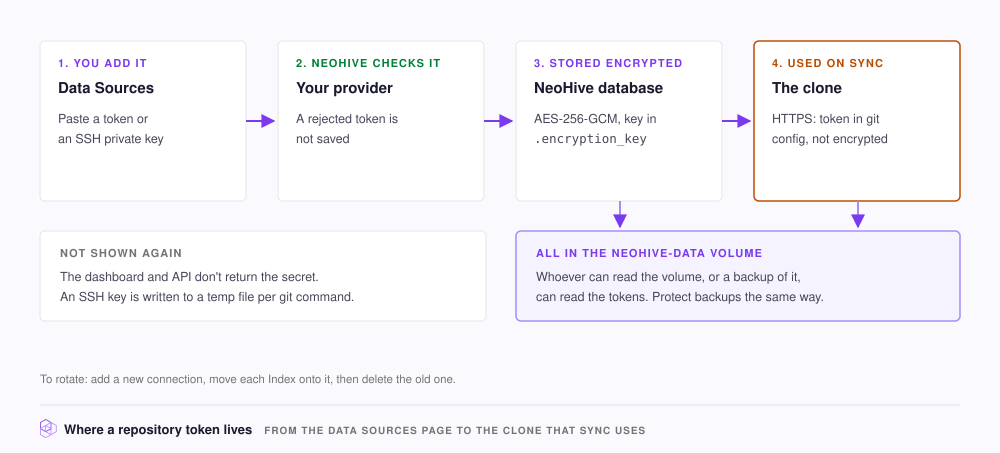

# Credentials and secrets

NeoHive stores the token or SSH key that reads your repositories, so that NeoHive can sync without asking you again. Before a security review or a backup, check where each secret lives, who can read it, and what happens when you remove it. The same facts matter when you choose a token's scopes. The following diagram shows where a token goes after you add it:

<figure><figcaption></figcaption></figure>

Each data source on the **Data Sources** page (`http://localhost:3577/sources`) can have several **connections**, for example one GitHub token for each organization. Each connection holds one secret: a personal access token or an SSH private key. The following table shows where NeoHive stores each secret and how it protects it:

| What | Where it lives | How it's protected |
|---|---|---|
| Each connection's token or SSH key | NeoHive's database in the `neohive-data` volume | NeoHive encrypts it with AES-256-GCM, a form of the Advanced Encryption Standard (AES). The dashboard and API don't show it |
| The encryption key | `/app/data/.encryption_key` in the same volume. NeoHive creates the file on first start, unless you set `MEMVEC_ENCRYPTION_KEY` | Only the file's owner can read the file that NeoHive creates. If you start the container yourself, you can pass your own 64-hex-character key in `MEMVEC_ENCRYPTION_KEY` instead. NeoHive then uses that key and ignores the file |
| An SSH key during a git command | A temporary file inside the container | Only the file's owner can read it. NeoHive deletes the file when the command ends |
| The token, for HTTPS clones | The clone's git config under `/app/data/repos/` | NeoHive doesn't encrypt it |


**Anyone who can read the `neohive-data` volume, or a backup of it, can read your tokens.** Protect backups the same way you protect the tokens. Give each token only the scopes NeoHive needs. For more information, see [Add a connection](../admin/data-sources.md#add-a-connection).


## Check, rotate, or remove a connection

NeoHive checks each new token with the provider and doesn't save a connection that the provider rejects. Deleting a connection removes only NeoHive's encrypted copy of its token. An existing clone still holds the token in its `.git/config` file, so also revoke the token with the provider. For more information about connection states and how to rotate a token, see [Check or remove a connection](../admin/data-sources.md#check-or-remove-a-connection).


**Keep the encryption key with the data.** If `/app/data/.encryption_key` is lost, NeoHive starts anyway and creates a new key. If `MEMVEC_ENCRYPTION_KEY` changes, NeoHive uses the new key. Either way, NeoHive can't decrypt the stored connections.

The connections stay on the **Data Sources** page, but every check and sync through them fails. You then need to add every connection again.


## Other secrets

NeoHive keeps two more secrets outside the connections:

| Secret | Where it lives | How it's protected |
|---|---|---|
| Your license key | The container's environment, set by the installer. The installer also saves a copy on the host in `~/.cache/neohive/license-key`. If you change the key in the dashboard, NeoHive saves the new key in its database | NeoHive doesn't encrypt it. Anyone who can run `docker inspect` on the host, or read the volume, can read it. Only your user account can read the copy on the host |
| The webhook secret | The `MEMVEC_WEBHOOK_SECRET` variable on the container, if you set it | NeoHive doesn't store it in the database. For more information, see [Webhook refresh endpoint](../reference/webhooks.md). |
