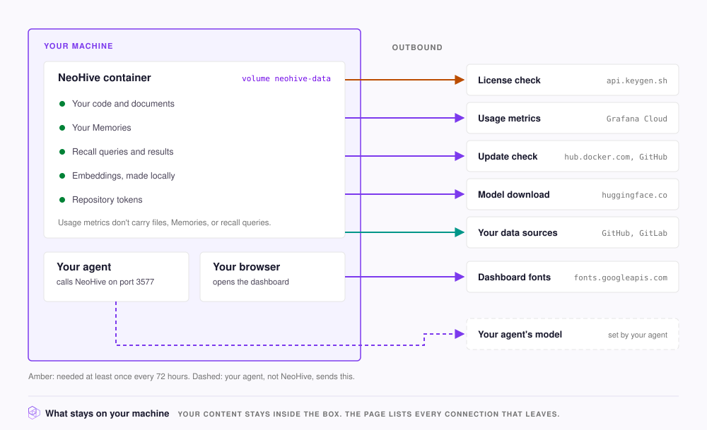

# What stays on your machine

NeoHive keeps your content on the machine it runs on, whether that's your own computer or a shared server for your team. The NeoHive container connects to a few outside services, for example to check your license.

An outbound connection is a request that NeoHive starts to another server. Before a security review or a firewall change, check what each connection sends and whether you can block it. The following diagram shows what stays on the machine and what leaves it:

<figure><figcaption></figcaption></figure>

All of your content stays on the machine NeoHive runs on: your code, documents, [Memories](../concepts/glossary.md#memory), and recall queries. NeoHive clones, indexes, and embeds your repositories there, and stores the clones and their [Indexes](../concepts/glossary.md#index) in the `neohive-data` Docker volume. NeoHive also stores your repository tokens there and sends each token only to its own provider.

## Outbound connections

Your content stays on the machine, but the NeoHive container makes the following outbound connections:

| Connection | Goes to | When | What it sends | Can you turn it off? |
|---|---|---|---|---|
| License check | `api.keygen.sh` | At start, about once an hour while NeoHive runs, once a day to recheck the license, and once when the container stops | Your license key, a random machine ID, and the container's platform and host name. The host name is the container's ID, not your computer's name | No. If NeoHive can't reach the licensing service, it keeps running for up to 72 hours from its last successful check. For more information, see [Check your license status](../admin/licensing.md#check-your-license-status). |
| Usage metrics | Grafana Cloud | Regularly while usage metrics are turned on. They're on by default | Counts, timings, and request details, described after this table | Yes. On the **Settings** page, under **Anonymous Telemetry**, turn off **Share anonymous performance data with the NeoHive team**. NeoHive keeps working |
| Update check | `hub.docker.com` and `raw.githubusercontent.com` | Shortly after start, then once a day | Nothing. The check reads the published version list and changelog | No setting, but you can block both hosts. The dashboard then stops showing new versions, and NeoHive keeps working |
| Model download | `huggingface.co` | When an embedding model isn't cached yet, including the first use after each update | Only the request for the file | No. The download happens once for each model, and again after an update. The document converter's models, including OCR, come with the container |
| Data sources | `github.com`, `api.github.com`, `gitlab.com`, or your own GitLab host. A connection with an SSH key uses SSH on port `22` | When you add a connection, and on each sync, including scheduled syncs | Your stored token or SSH key, to authenticate | Yes. Remove the Index and its connection |

Hugging Face redirects each model download to its content delivery network, on hosts under `hf.co` such as `us.aws.cdn.hf.co`. If your firewall allows traffic by host name, allow those hosts as well as `huggingface.co`.

Usage metrics don't include file contents, Memory text, recall queries, or tokens. Instead, they record how NeoHive runs: the NeoHive version, a hashed license ID, the random machine ID, the names of the MCP tools that your agents call, the IDs of the Indexes they search, and counts and timings, such as how many Memories a [Hive](../concepts/glossary.md#hive) holds. For each request, they also record the IP address and user agent of the agent or browser that sent the request, and the request's path and query string. The query string can hold text that you typed into the dashboard, such as a repository search. When a request fails, usage metrics add its error message and stack trace.

When usage metrics are turned off, each start of the container still sends one batch of runtime statistics, such as memory use, before NeoHive reads your setting. After that, usage metrics send nothing.


**The license check needs the internet.** NeoHive checks once a day, and stops if it can't reach the licensing service for 72 hours. On a network with a strict firewall, allow outbound HTTPS to `api.keygen.sh`. For more information about what happens when the check can't reach the internet, see [Check your license status](../admin/licensing.md#check-your-license-status).


## Connections from other parts of your setup

The installer, your browser, and the agent plugins make their own connections, outside the container. If you set up a firewall, check the following connections too:

| Connection | Goes to | When |
|---|---|---|
| The installer | `raw.githubusercontent.com`, Docker Hub, `api.keygen.sh` | When you run `install.sh` to install or update |
| The dashboard's fonts | `fonts.googleapis.com`, `fonts.gstatic.com` | When your browser opens the dashboard |
| The dashboard's release notes | `cdn.headwayapp.co` and Headway's servers | When your browser opens the dashboard |
| Smart prompt rewriting | The model provider that your `claude` CLI uses | Only after you turn it on with the plugin's `enable-smart-prompts` skill. The rewriting sends your prompt and the recalled results |

On a Mac with Apple Silicon, the installer can run embedding in a separate NeoHive worker on the Mac itself, outside Docker. The worker still runs on your machine. The worker downloads its embedding model from `huggingface.co` the first time it needs the model.

The Claude Code plugin writes a log of each session's NeoHive calls, including query text, to `~/.claude/neohive/sessions/` on your computer. The plugin doesn't send this log anywhere.


NeoHive returns context to your agent, and your agent sends that context to its own model provider as part of the conversation. Your agent's provider, not NeoHive, decides what happens to that context.

