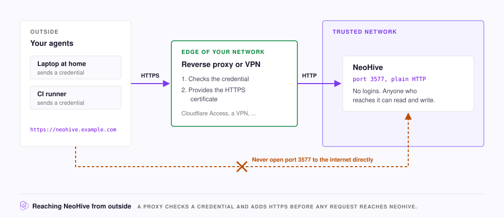

# Expose NeoHive beyond your network

NeoHive runs as a server, so your agents and your browser reach it over the network on port `3577`. If you chose another port with `NEOHIVE_PORT` when you installed, they use that port instead. The dashboard and the endpoints your agents connect to all use that one port.

What you set up depends on who else needs NeoHive. A teammate on your office network needs one setup, and an agent on a laptop outside that network needs another. The following table shows the setup for each case:

| Who needs to reach NeoHive | What to set up |
|---|---|
| Only you, on this machine | Use the default install. If the host is on a shared network, block port `3577` from other machines |
| Your team, on a trusted network or VPN | Run NeoHive on a host that their machines can reach. See [Access and sharing](../admin/access.md) |
| Anyone outside a trusted network | Follow [Advanced setup](#advanced-setup). Never open port `3577` directly |

## The default install is reachable from your network

The installer publishes port `3577` on every network interface of the host, not only on `localhost`. Any machine that can route to the host can open the dashboard and the MCP endpoints. On an office network, a shared server, or a cloud virtual machine, block the port at your network firewall or cloud security group.


On Linux, Docker writes its own firewall rules for published ports. As a result, a `ufw` rule on the host doesn't block port `3577`. Block the port at the network edge instead.


## Advanced setup

For access from outside your network, put a proxy in front of NeoHive, and have each agent send that proxy a credential. The following diagram shows the path each request takes:

<figure><figcaption></figcaption></figure>

### Put a proxy in front

NeoHive serves plain HTTP, so outside access needs a reverse proxy or VPN gateway in front of NeoHive. Cloudflare Access and a company VPN are two examples of such gateways. A reverse proxy is a server that receives each request and forwards it to NeoHive, but only after it checks the request's credential. The proxy also provides the HTTPS certificate, so point your agents at the `https://` address that the proxy exposes, for example `https://neohive.example.com/hives/<hive-id>/mcp`.

### Where your proxy checks the credential

Your proxy checks the credential, and NeoHive doesn't read it. The Claude Code plugin's hooks read the token from the `NEOHIVE_TOKEN` variable. The optional smart prompt rewriting in the Claude Code, Cursor, and Codex plugins reads it too. Both pass the token straight on to your proxy. NeoHive checks one secret of its own: the `X-Webhook-Secret` header on the [webhook refresh endpoint](../reference/webhooks.md).

### Pass the proxy's credential from each agent

Every MCP connection and the Claude Code hooks must send the header your proxy expects. The following examples send a bearer token from the `NEOHIVE_TOKEN` variable. NeoHive doesn't create this token, so set the variable to the token your proxy accepts. For more information about where to set the variable, see [Environment variables](../reference/environment-variables.md#agent-plugin).



To store the token and register the Hive at your proxy's address, run the following commands:

```bash
export NEOHIVE_TOKEN="<your-token>"
claude mcp add neohive 'https://neohive.example.com/hives/<hive-id>/mcp' \
  --scope project \
  --transport http \
  --header 'Authorization: Bearer ${NEOHIVE_TOKEN}' \
  --header 'x-mcp-client: claude-code'
```

The single quotes around the header write `${NEOHIVE_TOKEN}` into `.mcp.json` instead of the token itself. Claude Code fills in the token from your environment when it starts, so you can commit `.mcp.json` without the secret. Keep the `NEOHIVE_TOKEN` variable exported where Claude Code runs. The hooks send it as `Authorization: Bearer $NEOHIVE_TOKEN`. The command uses `--scope project` so that the hooks can find the server. For more information about how the hooks find the server, see [What the plugin does automatically](../results/plugin-automation.md#when-the-prompt-recall-adds-nothing).



Add the following entry to `.cursor/mcp.json`:

```json
{
  "mcpServers": {
    "neohive": {
      "url": "https://neohive.example.com/hives/<hive-id>/mcp",
      "headers": {
        "Authorization": "Bearer ${env:NEOHIVE_TOKEN}",
        "x-mcp-client": "cursor"
      }
    }
  }
}
```

Cursor fills in `${env:NEOHIVE_TOKEN}` from your environment when it loads the file, so `.cursor/mcp.json` holds no secret.



Add the following entry to `~/.codex/config.toml`:

```toml
[mcp_servers.neohive]
url = "https://neohive.example.com/hives/<hive-id>/mcp"
bearer_token_env_var = "NEOHIVE_TOKEN"
http_headers = { "x-mcp-client" = "codex" }
```



Desktop apps reach NeoHive through the `mcp-remote` bridge. Add each header with `--header`:

```json
{
  "mcpServers": {
    "neohive": {
      "command": "npx",
      "args": [
        "-y",
        "mcp-remote@latest",
        "https://neohive.example.com/hives/<hive-id>/mcp",
        "--header",
        "Authorization: Bearer <your-token>",
        "--header",
        "x-mcp-client: claude-desktop"
      ]
    }
  }
}
```




The hooks send `NEOHIVE_TOKEN` in the `Authorization` header and nothing else, so they skip the other headers in your MCP configuration. Your proxy might need other headers, such as Cloudflare Access service-token headers. In that case, your agent's own tool calls still work, but the automatic recall on each prompt doesn't reach NeoHive.

