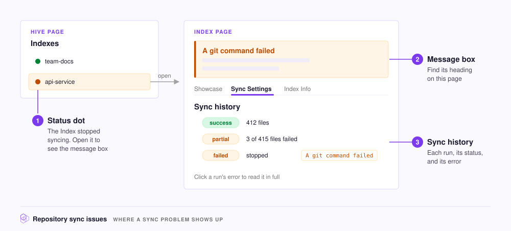

# Repository sync issues

A [Code](../concepts/glossary.md#code-index) or [Documentation Index](../concepts/glossary.md#documentation-index) stays current by syncing with its repository on a schedule. When a sync fails, stalls, or leaves files out, the [Index](../concepts/glossary.md#index) falls out of date and your agent recalls older content.

The following diagram shows the three places in the dashboard where a sync problem shows up:

<figure><figcaption></figcaption></figure>

## What the Index page shows

Open the Index, and find the heading of the message box you see. To read a run's error in full, click its text in the **Error** column of **Sync history**.

### A synced branch is no longer on the remote

Someone renamed or deleted the branch. Everything indexed so far is still searchable.

To sync another branch, do the following:

1. Under **Pick a branch to sync instead**, select a branch.
2. Click **Sync this branch**.

If the Index still does not sync, click **Re-clone repository**. NeoHive switches most renamed default branches, such as `master` to `main`, on its own.

### A git command failed

NeoHive could not read the repository. The line under the heading shows git's own reason, such as a failed login or a wrong URL. To check the connection, see [Connections](#connections). After you fix the connection, click **Trigger sync**.

### The connection for this Index was removed

Someone deleted the Index's connection on **Data Sources**. Click **Assign connection**, and then select a connection. If the service has no connection left, the button reads **Add a data source** and opens **Data Sources**.

### Some files could not be indexed, the rest synced

The text under the heading says which case you have:

* **`<n> of <m> files failed to index and will be reindexed automatically.`** No action is needed. NeoHive retries those files two minutes later.
* **`<n> files could not be indexed after 3 attempts. Trigger a sync to retry.`** Read the file's error in **Sync history**. Fix the file, or exclude it with the **Blocklist**, and then click **Trigger sync**.

### No files could be indexed, so the sync stopped

Every file in the run failed to index. The box shows the first file's error. If the error names the container or the embedding engine, see [Agent can't connect](connection.md). Then click **Trigger sync**.

### This Index was built with the wrong embedding dimensions

NeoHive cannot repair the Index in place, so you create it again. To rebuild the Index, do the following:

1. Open the **Index Info** tab.
2. Under **Danger Zone**, click **Delete Index**.
3. On the [Hive](../concepts/glossary.md#hive) page, click **Add Index**, and create the Index with the same source and embedding model.

### The sync failed

Something else failed, and the box shows the error message. Look up the message in [Common errors](common-errors.md).

### Syncing is paused, or a sync is already running

These two states are not errors. If **Sync Settings** shows **Resume syncing**, syncing is paused. To resume, click **Resume syncing**. If you see `A sync is already running for this Index`, you clicked **Trigger sync** during a run. Wait for that run to finish.

## Connections

To check a connection, open **Data Sources** and click **Manage** on the service. A connection marked **Invalid** has a token that no longer works, so its syncs fail with `A git command failed`. Add a new connection with a working token, and assign it to the Index. For more information, see [Data sources and credentials](../admin/data-sources.md#check-or-remove-a-connection).

## Slow or stalled syncs

The first sync indexes every file, so a large repository takes longer. Later syncs index only the files that changed, unless you change the **File filters**. If progress stops, read the log:

```bash
docker logs neohive --tail 50
```

## Schedule

If an Index syncs too often or too rarely, change its **Sync interval** on the **Sync Settings** tab. For more information about the intervals you can choose, see [Set the schedule](../context/repositories/sync.md#set-the-schedule). To sync now, click **Trigger sync**, or call the [webhook refresh endpoint](../reference/webhooks.md) from your CI system.

## Files that never appear

A file must pass the built-in skip list, your **Allowlist**, and your **Blocklist**. The skip list leaves out binary files, including PDFs, lock files, and dependency folders. For more information, see [Files in a repository](../reference/file-types.md#files-in-a-repository) and [File pattern syntax](../reference/file-patterns.md).

## Still stuck?

To get help, do the following:

1. To collect a diagnostics bundle, run the following command:

   ```bash
   curl -fsSL https://raw.githubusercontent.com/NeoHiveAI/install/main/logs.sh | bash
   ```

2. Send the bundle to `hello@neohive.ai` with the name of the repository that fails.

The bundle holds logs and settings with secrets removed. The bundle does not include your [Memories](../concepts/glossary.md#memory), code, or databases.
