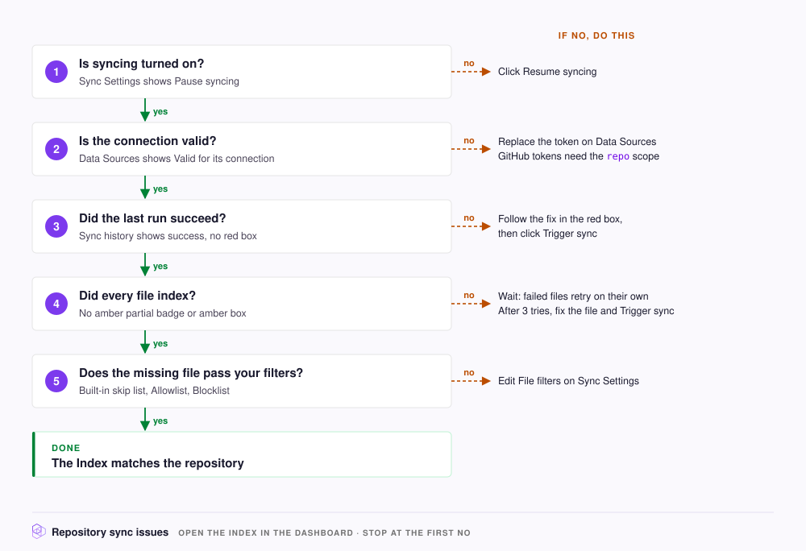

# Repository sync issues

A [Code](../concepts/glossary.md#code-index) or [Documentation Index](../concepts/glossary.md#documentation-index) stays current by syncing with its repository on a schedule. When a sync fails, stalls, or leaves files out, the [Index](../concepts/glossary.md#index) falls out of date and your agent recalls older content. The checks on this page find the cause and get the Index syncing again.

<figure><figcaption></figcaption></figure>

Open the Index in the dashboard. When a sync has a problem, a message box at the top of the Index page names the problem and says what to do. The same message box appears on the [Hive](../concepts/glossary.md#hive) page, with a link to the Index, and the Index shows a red status dot in the Hive's **Indexes** list. On the **Sync Settings** tab, **Sync history** lists every run with its status. To read a run's error in full, select the text in its **Error** column.

## What the Index page shows

Text in `<angle brackets>` stands for a value that changes, such as a branch name or a count.

| You see | Cause | Fix |
|---|---|---|
| **Resume syncing** on **Sync Settings** | Syncing is paused, so no scheduled sync runs. | Select **Resume syncing**. |
| `The connection for this Index was removed` | Someone deleted the Index's connection on **Data Sources**. | Select **Assign connection** and choose a connection. If the Index's service has no connection left, the button reads **Add a data source** and opens **Data Sources**. |
| `A synced branch is no longer on the remote` | Someone renamed or deleted the branch, and NeoHive could not pick its replacement. The box says that the Index won't pick up new changes for now, and that everything indexed so far is still searchable. | Under **Pick a branch to sync instead**, select a branch, and then select **Sync this branch**. The sync starts on the new branch. If the Index still does not sync, select **Re-clone repository**, which clears the local copy and clones the repository again. |
| `A git command failed` | NeoHive could not read the repository. The line under the heading shows git's own reason, such as a failed login or a wrong URL. | Check the connection on **Data Sources**, and then select **Trigger sync**. See [Connections](#connections). |
| `No files could be indexed, so the sync stopped` | Every file in the run failed to index. The box shows the first file's error. | Read the error. If it names the container or the embedding engine, see [Agent can't connect](connection.md). Then select **Trigger sync**. |
| `The sync failed` | Something else failed. The box shows the error message. | Look up the message in [Common errors](common-errors.md). |
| `This Index was built with the wrong embedding dimensions` | NeoHive cannot repair the Index in place. | Follow the three steps in the box: open the **Index Info** tab, select **Delete Index** under **Danger Zone**, and then select **Add Index** on the Hive page to create the Index again with the same source and embedding model. |
| `Some files could not be indexed, the rest synced`, with `<n> of <m> files failed to index and will be reindexed automatically.` | Some files failed to index. The run also shows an amber **partial** badge in **Sync history**. | No action is needed. NeoHive runs the sync again two minutes later and retries those files. |
| `Some files could not be indexed, the rest synced`, with `<n> files could not be indexed after 3 attempts. Trigger a sync to retry.` | The same files failed three syncs in a row, so NeoHive stopped retrying them. | In **Sync history**, select the run's error to read the first file's error. Fix the file, or exclude it with the **Blocklist**, and then select **Trigger sync**. |
| `A sync is already running for this Index` | You selected **Trigger sync** while a sync was running. | No fix is needed. Wait for the running sync to finish. |

NeoHive usually handles a renamed default branch, such as `master` to `main`, for you. NeoHive switches the Index to the new branch and continues syncing. The branch message box appears only when NeoHive cannot tell which branch replaced the old one.

You can also change the branch on the **Sync Settings** tab. Select the new branch under **Branch**, and then select **Save settings**. When the old branch was missing, NeoHive clears the message box and starts a sync on the new branch.

## Connections

A connection is the saved GitHub or GitLab login that an Index syncs through. To check one, open **Data Sources** and select **Manage** on the service. Each connection shows **Valid**, **Invalid**, or **Unvalidated**. If a token no longer works, every sync that uses the token fails with `A git command failed`. Add a new connection with a working token, and then assign the new connection to the Index. For the steps, see [Data sources and credentials](../admin/data-sources.md#check-or-remove-a-connection).

## Slow or stalled syncs

The first sync clones the repository and indexes every file, so a large repository takes longer. The Index page shows the sync's progress. Later syncs index only the files that changed. If you change the **File filters**, the next sync checks every file again. If progress stops, read the log:

```bash
docker logs neohive --tail 50
```

## Schedule

If an Index syncs too often or too rarely, change its **Sync interval** on the **Sync Settings** tab. For the intervals you can choose, see [Set the schedule](../context/repositories/sync.md#set-the-schedule). To sync now, select **Trigger sync**, or call the [webhook refresh endpoint](../reference/webhooks.md) from your CI system.

## Files that never appear

A file must pass the built-in skip list, your **Allowlist**, and your **Blocklist**, in that order. The skip list covers binary files, lock files, and dependency folders, and a PDF in a repository counts as binary. For the full skip list, see [Files in a repository](../reference/file-types.md#files-in-a-repository). To see how the Allowlist and Blocklist combine, read [File pattern syntax](../reference/file-patterns.md).

## Still stuck?

To get help, do the following:

1. Run the following command to collect a diagnostics bundle:

   ```bash
   curl -fsSL https://raw.githubusercontent.com/NeoHiveAI/install/main/logs.sh | bash
   ```

2. Send the bundle to `hello@neohive.ai` with the name of the repository that fails.

The bundle holds logs and settings with secrets removed. The bundle never includes your [Memories](../concepts/glossary.md#memory), code, or databases.
